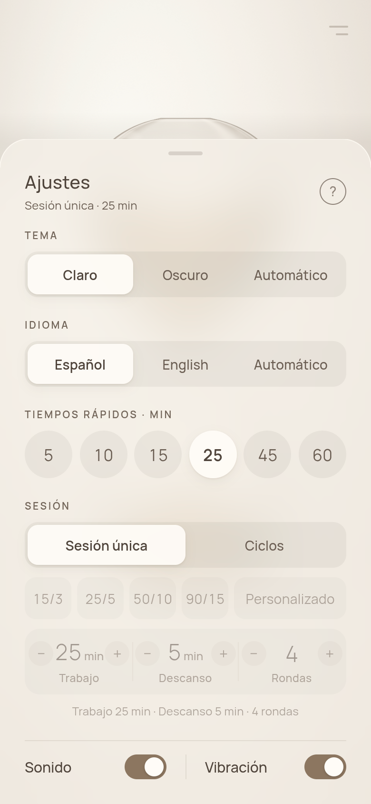
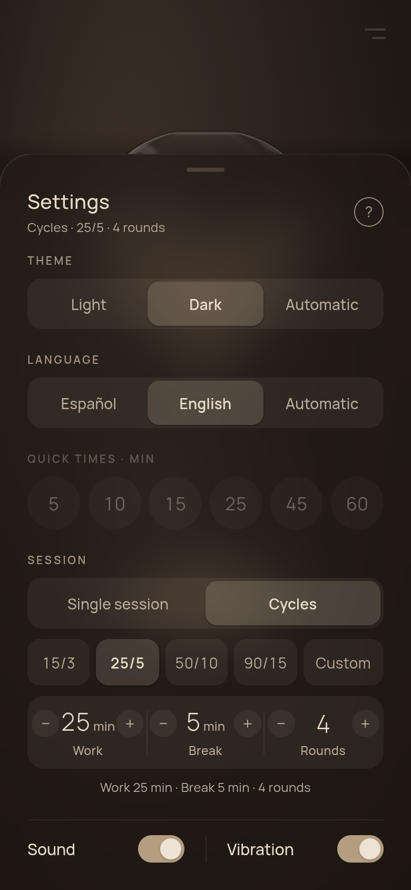
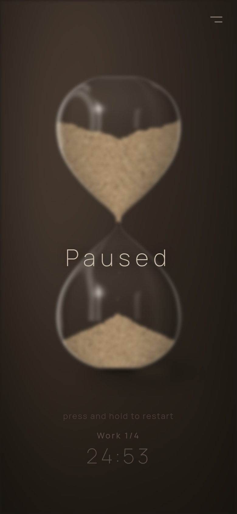
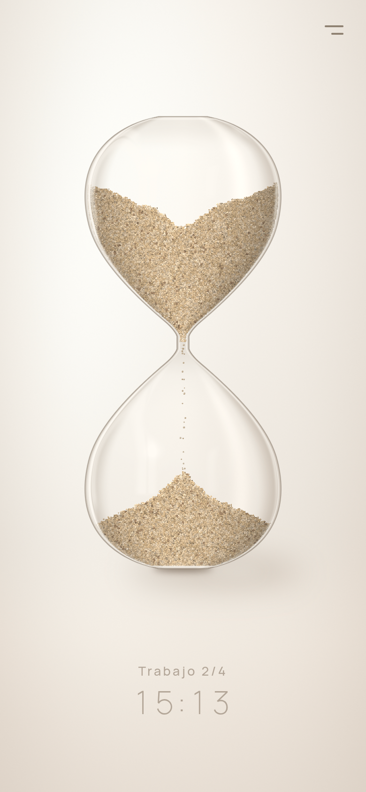

# Historial de cambios

Notas de cada entrega del **Reloj de Arena**: qué cambió, cómo actualizar desde la versión
anterior, memoria y rendimiento medidos y las pruebas manuales de cada una. Las versiones más
recientes van primero. La documentación general está en el [README](README.md) y el
funcionamiento interno en [docs/ARQUITECTURA.md](docs/ARQUITECTURA.md).

> Las entregas 1.0–1.4 se hicieron como carpetas comprimidas (`reloj-de-arena-fase1.x.zip`) y un
> APK de desarrollo. A partir de la publicación en GitHub basta con `git pull`; las
> instrucciones «Cómo actualizar» se conservan como referencia.

## Sin publicar — Licencia: de MIT a PolyForm Noncommercial 1.0.0

Solo documentación y licencia; la app no cambia y no hace falta un APK nuevo.

- `LICENSE` (MIT) se sustituye por [`LICENSE.md`](LICENSE.md): el texto oficial, sin cambios, de
  la **PolyForm Noncommercial 1.0.0**, precedido del aviso obligatorio («Required Notice»).
- El campo `license` de los tres `package.json` (y de `package-lock.json`) pasa a
  `PolyForm-Noncommercial-1.0.0`.
- Nueva sección [Licencia](README.md#licencia) en el README: uso personal o no comercial; sin uso
  comercial ni redistribución con ánimo de lucro sin permiso; el nombre, el logo y los gráficos
  no entran en la licencia.
- [THIRD_PARTY_NOTICES.md](THIRD_PARTY_NOTICES.md) indica la nueva licencia del proyecto; las
  licencias de las dependencias no cambian. Revisadas las dependencias de producción: ninguna
  GPL, AGPL ni LGPL que obligue a cambiar la licencia de la app.
- Política de privacidad en español ([`docs/privacidad.html`](docs/privacidad.html)) e inglés
  ([`docs/privacy.html`](docs/privacy.html)), con el nombre **Hourglass Pomodoro**, enlazada
  desde la nueva sección [Privacidad](README.md#privacidad) del README.

## 1.8.10 — Menú a mano: botón abajo a la derecha, etiquetas en los botones redondos y menú cerrado al volver

Tres mejoras de uso aprobadas. La arena no cambia: el menos detalle durante un giro fuerte
(`TiltLod`) y la sensibilidad a la inclinación se quedan como en la 1.8.9.

### Botón del menú abajo a la derecha

Las dos rayas de «Ajustes» bajan de la esquina de arriba a la derecha a la de **abajo a la
derecha**, cerca del pulgar: el menú se abre con una mano.

- Van centradas en su zona táctil de **84 × 84 dp** (mucho más que 48 dp), por **encima de la
  barra de gestos** (margen seguro de abajo) y por debajo de la línea del tiempo, que va
  centrada: no tapan el tiempo, la pista ni el rótulo de la fase.
- La **zona de guarda** (donde los gestos del reloj no hacen nada, 1.6) se mueve con el botón:
  de pie, abajo a la derecha; con el móvil volteado (la capa del menú gira 180°), arriba a la
  izquierda. Arriba a la derecha vuelve a ser reloj: un toque ahí empieza o pausa.
- **Con la hoja abierta el botón se esconde** (se funde con la subida de la hoja, sin toques y
  fuera del lector de pantalla) y vuelve al cerrarse. La hoja se cierra como siempre: tocando
  fuera, arrastrando hacia abajo, con «atrás» (Escape en la web) o con el asa «Cerrar
  ajustes» del lector de pantalla.

### Etiquetas al mantener pulsado un botón redondo

En la fila de botones redondos (Tema, Idioma, Sonido, Vibración y Ventana flotante),
**mantener pulsado** (450 ms) enseña encima una etiqueta pequeña con el nombre del control
(«Tema», «Idioma», «Sonido», «Vibración», «Ventana flotante»; en inglés, «Theme»,
«Language»…; los textos de siempre), con un clic suave de vibración si está activada.

- Al soltar después de la etiqueta, el botón **no** se activa (como las etiquetas de
  Android): mantener pulsado es para preguntar qué es. La etiqueta se va 1,5 s después.
- Si el dedo **se va del botón** antes de soltar (más de 24 dp, medio botón, desde donde
  bajó), la pulsación se cancela: al soltar no pasa nada, aunque el dedo vuelva encima.
- Un toque normal funciona igual que antes.
- Aspecto: una píldora del color de la hoja (beige cálido en el claro, gris tostado en el
  oscuro; color nuevo `tooltip` de la paleta, casi opaco), texto Manrope en el tono del menú
  (contraste ≥ 9:1) y la misma sombra suave que las opciones elegidas. Va centrada sobre el
  botón sin salirse de la hoja (el primer y el último botón la llevan pegada al borde).
- Solo para la vista: el lector de pantalla ya dice el nombre de cada botón.
- Core (con pruebas): `QuickPress` (toque, pulsación larga, cancelación al alejarse) y
  `tooltipLeft` (posición dentro de la fila).

### El menú se cierra al salir de la app

Si se abre el menú, se va a Inicio (u otra app) y se vuelve, el reloj sigue como estaba (en
marcha, si lo estaba), pero **el menú aparece cerrado**. Se cierra al pasar a segundo plano,
sin animación (al volver no se ve bajar), y el botón abre enseguida al primer toque
(`useSheet.hideNow`, `SheetToggle.reset`, `closesMenuOnAppState` en el core).

El diálogo del permiso de notificaciones que se pide desde el aviso del menú también pone la
app en segundo plano en Android, pero no es salir de ella: mientras está abierto, el menú se
queda (`withSystemPrompt`). Ir a los ajustes del sistema sí cuenta como salir.

### Cómo actualizar

- Solo cambia el JavaScript, pero hay que instalar el **APK nuevo**. Los ajustes no cambian de
  formato.

### Pruebas

- `npm run check`: tipos, lint, formato, 250 pruebas del core (16 nuevas: `QuickPress` —toque,
  pulsación larga sin activar, cancelación al alejarse y al volver encima, cada pulsación de
  cero—, `tooltipLeft`, `SheetToggle.reset`, `closesMenuOnAppState`, y la zona de guarda abajo
  a la derecha y volteada arriba a la izquierda) y los 855 worklets del bundle de Android.
- Web (Chromium, 412 × 915, claro y oscuro, español e inglés): el botón ocupa la esquina de
  abajo a la derecha (84 × 84); con la hoja abierta su opacidad es 0; mantener pulsado Sonido
  enseña «Sound» encima (en inglés; Vibración, «Vibración» en español y oscuro) y al soltar no
  cambia; deslizar fuera (y deslizar fuera y
  volver) no cambia; un toque sí; las etiquetas de Tema y Vibración no se salen de la fila;
  simulando salir y volver (`visibilitychange`) con el menú abierto, la hoja queda cerrada y el
  botón la vuelve a abrir al primer toque.
- APK: 1.8.10 (10810), solo arm64-v8a, 21,9 MB, con `--expect` del código nuevo en el bundle
  (`etiqueta-rapida` y los dos colores nuevos `tooltip` de la paleta).
- Sin el móvil: falta probarlo en el A55 (ver «Qué probar»).

### Qué probar en el móvil

1. **Botón abajo a la derecha:** con una mano, tocar las dos rayas: se abre el menú y el botón
   desaparece; al cerrar (tocando fuera, arrastrando o «atrás») vuelve. No choca con la barra
   de gestos ni con el tiempo.
2. **Esquina sin gestos:** con el reloj parado, tocar justo alrededor del botón abre el menú y
   no empieza el tiempo; deslizar desde ahí no cambia la duración. Tocar arriba a la derecha
   ahora sí empieza o pausa.
3. **Volteado:** voltear el móvil: el botón queda en la esquina de abajo a la derecha de lo que
   se ve (arriba a la izquierda de la pantalla) y abre el menú derecho.
4. **Etiquetas:** en el menú, mantener pulsado cada botón redondo: sale su nombre encima, con
   un clic, y al soltar no cambia nada. Probar el primero y el último (no se salen de la hoja),
   en claro y oscuro.
5. **Cancelar:** pulsar Sonido, deslizar el dedo fuera y soltar: no cambia. Un toque normal sí.
6. **Volver a la app:** con el reloj en marcha, abrir el menú, ir a Inicio y volver: el reloj
   sigue en marcha y el menú está cerrado. Igual desde «Recientes».
7. **Permiso de notificaciones** (si sale el aviso en el menú): tocarlo y responder al diálogo:
   el menú sigue abierto.

### Versión

- `versionCode` 10810.

## 1.8.9 — Sin diagnóstico, vidrio sin desenfoque y menos detalle solo en un giro fuerte

### Se quita el modo diagnóstico

Probada la 1.8.8 en el A55, la hoja ya no vibra: el diagnóstico (1.8.3–1.8.8) ha cumplido. Se
quita entero, sin interruptores muertos: la pulsación larga en «Ajustes», el recuadro de
mediciones (fps, tiempos de apertura, paradas, llamadas nativas, alto de la hoja), la sección
«Diagnóstico» del menú con sus opciones y «Borrar mediciones» (`src/dev/diagnostics.ts` y
`DiagnosticsOverlay.tsx`). Lo guardado del diagnóstico en el móvil
(`reloj-de-arena/diagnostico`) se queda sin leer; no molesta. Con él se van el interruptor de
fila (`ToggleRow`, que solo usaba el diagnóstico desde la 1.8.8) y sus colores.

### Lo que se queda: lo que mejor se veía en las pruebas

Las opciones elegidas en el diagnóstico pasan a ser el único comportamiento:

- **Vidrio: sin desenfoque.** El panel de la hoja es el del modo «Sin desenfoque»: un degradado
  del color del tema, casi opaco (93–96 %), con el velo, la sombra del canto y el filo de luz
  de siempre. Sin `BackdropBlur` ni foto fija: no se lee la pantalla ni se copia nada en la GPU
  en cada fotograma.
- **Fondo del vidrio: en movimiento.** Sin desenfoque ya no hay foto que hacer: se quitan la
  foto fija de la 1.8.7 (`glassBackdrop.ts`, `sceneImage.ts`; en el core `StillBackdropGate`,
  `stillBlur`) y `glassBlur`. El fundido del tema vuelve a ser la foto del lienzo, también con
  la hoja abierta (lleva el panel y se funde igual).
- **Hoja con animación:** la misma subida y bajada (340 / 260 ms); sin animación solo con
  «reducir movimiento».
- **Arena en movimiento con el menú abierto:** ya no hay forma de congelarla.

Se quedan como estaban: el desenfoque del reloj **en pausa** (2,5 px con el dedo, 9 px de lado,
y creciendo hasta 9 px con el menú delante), el alto estable de la hoja de la 1.8.8
(`settleMeasure` / `sheetLayout`, alto al píxel) y el canto al píxel de la 1.8.7
(`snapToPixel`, que pasa a `core/src/menu/pixel.ts`).

### Pista de la pausa con el dedo

En pausa con el móvil de pie, la pista dice cómo seguir: **«pulsa para seguir · mantén pulsado
para reiniciar»** (en inglés, «tap to resume · press and hold to restart»). La pausa de tumbar
el móvil no cambia: sin pista hasta que se toca, y entonces «ponlo de pie para seguir». La
pista va en una sola línea y encoge un poco en un móvil estrecho en vez de partirse.

### Menos detalle solo durante un giro fuerte

**Qué pasaba:** al inclinar mucho el móvil (sin voltearlo), casi toda la arena corre hacia el
otro lado y la animación bajaba a ~4 fps. **Por qué** (medido en el core): cada vez que la
gravedad de la simulación cambia de escalón (3°) la simulación reordena todas sus celdas
(`ensureOrder`, unas 15 veces lo que cuesta un paso normal), y girando eso pasa casi en cada
fotograma; además, con miles de granos en movimiento cada paso cuesta más y, a pocos fps, la
puesta al día (`MAX_CATCH_UP`) daba hasta 3 veces más pasos por fotograma, lo que lo hundía más.

**Ahora** (`TiltLod`, core, con pruebas): si el móvil se ha girado **40° o más** desde la última
vez que estuvo quieto **y** la simulación cuesta **24 ms o más** en dos fotogramas (el móvil no
llega), durante unos segundos:

- la gravedad de la simulación va en escalones de **10°** en vez de 3° (unas tres veces menos
  reordenaciones; 10 divide 90, así que de pie y de lado la arena sigue cayendo recta). El
  dibujo, el chorro y la luz siguen con la gravedad suave: el giro se ve continuo;
- no hay puesta al día (un paso doble por fotograma);
- la luz y los reflejos del vidrio se regraban 10 veces por segundo en vez de 20.

Se apaga **2,5 s** después de que el móvil deja de girar: la arena se recoloca los pocos grados
que falten con una sola reordenación. De pie, de lado quieto, con inclinaciones normales o en
un móvil que llega, no se activa nunca; voltear (180°) lo apaga. No es un sistema general para
móviles lentos: solo este pico. Falta comprobar en el A55 que se ve bien.

### Cómo actualizar

- Solo cambia el JavaScript, pero hay que instalar el **APK nuevo**. Los ajustes no cambian de
  formato.

### Pruebas

- `npm run check`: tipos, lint, formato, 234 pruebas del core (nuevas: `TiltLod` —quieto, de
  lado, móvil que llega, giro fuerte que se activa y se apaga, escalones de 10°, de pie recta,
  la arena acaba en el mismo lado— y los textos de la pausa; se van las del fondo fijo y
  `glassBlur`) y los 854 worklets del bundle de Android.
- APK: 1.8.9 (10809), solo arm64-v8a, 21,9 MB, con `--expect` de los textos de la pausa y de
  `TiltLod`; en el bundle ya no están los textos del diagnóstico. `npm run apk` busca ahora cada
  `--expect` también en UTF-16: Hermes guarda así las cadenas con caracteres no ASCII («·»,
  tildes) y el texto nuevo de la pausa no se encontraba.
- Sin el móvil: falta probarlo en el A55 (ver «Qué probar»).

### Qué probar en el móvil

1. **Menú con el reloj en marcha:** abrir y cerrar varias veces. La hoja sube y baja animada, el
   panel es el de «Sin desenfoque» y la arena sigue cayendo por fuera. Una pulsación larga en
   «Ajustes» ya no hace nada.
2. **Pausa con el dedo** (de pie): sale «pulsa para seguir · mantén pulsado para reiniciar» en
   una línea; tocar sigue y mantener reinicia. En inglés, «tap to resume · press and hold to
   restart».
3. **Pausa de lado:** tumbar el móvil: «Pausa» girado, sin pista; tocar da el clic y «ponlo de
   pie para seguir»; de pie, sigue.
4. **Giro fuerte:** con el reloj en marcha y mucha arena arriba, inclinar el móvil unos 120–150°
   (sin voltearlo) y volver. ¿Va más fluido que la 1.8.8? ¿Se ve bien la arena corriendo? Al
   pararse, en unos 3 s la arena se asienta del todo.
5. **Uso normal:** de pie e inclinaciones suaves, igual que antes (la arena se desliza fina).
6. **Tema con el menú abierto:** cambiar de tema con la hoja abierta: se funde todo junto.
7. **Pausa con el menú:** en pausa, abrir el menú: el reloj se desenfoca detrás como antes.

### Versión

- `versionCode` 10809.

## 1.8.8 — Menú compacto (disposición B) y hoja con un alto estable

### Menú compacto: la hoja queda baja, cerca del pulgar

La disposición **B** de las maquetas (rama `propuestas-menu`), elegida el 24 de octubre, es ya el
único menú:

- **Pestañas «Sesión única» / «Ciclos»** que solo enseñan lo de la pestaña elegida: los tiempos
  rápidos, o el ciclo (preajustes, Personalizado, trabajo / descanso / rondas y su resumen). La
  pestaña es el modo de sesión guardado, así que **al abrir sale siempre el último modo usado**
  (no vuelve a sesión única). Cambiar de modo cuesta un toque más, pero casi nunca se hace.
- **Una fila de botones redondos** al pie: **Tema** y **Idioma** (cambian al tocarlos: Claro →
  Oscuro → Automático; Español → English → Automático), una raya fina, y **Sonido**,
  **Vibración** y **Ventana flotante** (solo Android) como interruptores redondos, rellenos del
  color de acento si están encendidos.
- **Alto:** en sesión única la hoja mide unos **333 dp + el margen de la barra de gestos** (unos
  380 dp con el aviso de permisos), frente a unos **800 dp** de la 1.8.7. En ciclos, unos 430 dp
  (+ margen y aviso).
- Se conservan el vidrio esmerilado (con el fondo fijo de la 1.8.7), la paleta cálida, Manrope,
  el tema claro / oscuro, el «?» de los gestos, el aviso de permisos y el de la ventana flotante
  (Android) y el diagnóstico oculto (pulsación larga de 1,2 s en «Ajustes»).
- **Iconos:** trazos finos de Skia (sin dependencias nuevas). Su color se calcula en el hilo de la
  interfaz a partir del progreso del tema: **se funden con el resto del menú** al cambiar de tema
  (en la maqueta cambiaban de golpe). Encendidos, el icono va en un color nuevo de la paleta,
  `onAccent` (claro sobre el acento en el tema claro, oscuro en el oscuro: contraste ≥ 4:1; el
  claro de la maqueta sobre el acento del tema oscuro se quedaba en 2:1).
- Se quitan el selector `?menu=A|B|C` / `NATIVE_LAYOUT` y las maquetas A y C: no llegan a `main`.
  La rama `propuestas-menu` se queda como estaba.

### Accesibilidad

- Botones de 48 × 48 dp.
- Sonido, Vibración y Ventana flotante: rol **interruptor** con su estado (activado / desactivado).
- Tema e Idioma dicen su valor actual («Tema: Oscuro», «Idioma: English») con la pista **«Toca
  para cambiar»**, y al tocarlos se anuncia el valor nuevo (si cambia el idioma, ya en el nuevo).
- Textos nuevos en el core, en los dos idiomas: `tapToChange`, `settingValue`, `automaticShort`
  («Auto» dentro del botón de idioma). Los textos de la maqueta ya no existen.

### La hoja «vibraba» a su alto normal

**Qué se veía (1.8.7):** con la hoja a su alto normal, la hoja temblaba; con el diagnóstico
abierto (hoja más alta, al máximo y con desplazamiento) dejaba de temblar. El fondo fijo o en
movimiento casi no cambiaba nada.

**Causa probable: la hoja peleaba con su propio alto.** La hoja mide su cabecera y su cuerpo
(`onLayout`, redondeado hacia arriba al punto) y se pone ese alto; su posición (pegada abajo)
depende de ese alto. En Android, Yoga redondea cada vista al **píxel físico según dónde cae**:
la misma cabecera mide un píxel más o menos según la posición de la hoja. Al redondear al punto,
ese píxel podía ser un punto entero: la hoja cambiaba de alto, se movía, se volvía a medir con
otro redondeo… y subía y bajaba uno o dos puntos sin parar. Con el diagnóstico abierto la hoja
estaba al máximo, un alto que no depende de la medida: por eso paraba. Una simulación del
redondeo (en las pruebas del core) lo reproduce con algunos altos y no con otros, lo que encaja
con que no pasara en todas las pantallas.

**Arreglo** (core: `settleMeasure` y `sheetLayout`, con pruebas):

- Una medida que **crece** se acepta siempre (nada se corta); una que **encoge** solo si encoge
  más de 2 puntos (otra pestaña, un aviso que se va). Un vaivén de un píxel se queda en el valor
  mayor y la hoja no se mueve más.
- El alto se redondea hacia arriba **al píxel físico** (no al punto): el canto cae siempre en un
  píxel entero.
- El alto pasa al vidrio en un `useLayoutEffect` (antes en un `useEffect`): la vista y el vidrio
  cambian de alto en el mismo fotograma (al cambiar de pestaña, por ejemplo).
- El alto no se anima ni se mide en cada fotograma: solo cambia cuando cambia el contenido.
- **Diagnóstico:** el recuadro muestra el alto de la hoja y cuántas veces ha cambiado con la hoja
  abierta. Con el menú abierto y quieto el número no debe subir; cambiar de pestaña o abrir el
  diagnóstico lo sube una vez.

Sin cambios en el vidrio: sigue el fondo fijo de la 1.8.7 por defecto y el «Fondo del vidrio:
Fija / En movimiento» del diagnóstico.

### Cómo actualizar

- Solo cambia el JavaScript, pero hay que instalar el **APK nuevo** (no hay actualizaciones por
  el aire). Los ajustes no cambian de formato.

### Pruebas

- `npm run check`: tipos, lint, formato, 236 pruebas del core (16 nuevas: alto estable de la
  hoja con la simulación del bucle, fila de ajustes rápidos, último modo recordado) y los 872
  worklets del bundle de Android.
- Web (Chrome, 412 × 915): alto de la hoja estable en 10 medidas seguidas, en claro y oscuro,
  sesión única (333 dp) y ciclos (432 dp); Tema y Idioma rotan y cambian su etiqueta; los
  interruptores cambian `aria-checked`; la pestaña Ciclos sigue elegida tras recargar; la
  pulsación larga en «Ajustes» abre el diagnóstico.
- APK: 1.8.8 (10808), solo arm64-v8a, con `--expect` del código nuevo en el bundle.
- Sin el móvil: falta probarlo en el A55 (ver «Qué probar»).

### Qué probar en el móvil

1. **Reloj en marcha, abrir el menú** (diagnóstico apagado): ¿se ha ido la vibración con la hoja
   más baja? Dejarla abierta unos segundos mirando el canto y los botones.
2. Encender el diagnóstico (1,2 s en «Ajustes»): la línea «hoja … dp · cambios de alto con la
   hoja abierta: N». Con el menú quieto, N no debe subir.
3. **Último modo:** elegir «Ciclos», cerrar, reabrir (y también cerrar la app y volver): sale
   la pestaña Ciclos. Igual con «Sesión única».
4. **Botones redondos:** Sonido, Vibración y Ventana flotante se encienden (acento) y apagan; la
   ventana flotante sigue pidiendo su permiso y el aviso aparece debajo si falta.
5. **Tema e Idioma:** tocar varias veces: Claro → Oscuro → Automático; ES → EN → Auto. Al
   cambiar de tema, los iconos se funden con el resto del menú (sin cambiar de golpe).
6. **Ciclos:** la pestaña muestra preajustes, Personalizado y los steppers; tocar + en Trabajo
   pasa a Personalizado; la arena se pone al día.
7. **TalkBack** (si se puede): «Sonido, interruptor, activado»; «Tema: Oscuro, botón, Toca para
   cambiar»; al tocar dice el valor nuevo («Idioma: English» en inglés).

### Versión

- `versionCode` 10808.

## 1.8.7 — Vidrio del menú sobre una foto fija: sin temblor con la arena cayendo

### Qué pasaba (1.8.6, Samsung A55)

Con el reloj en marcha y el menú abierto, el desenfoque de dentro de la hoja **temblaba o
brillaba sin parar**, sobre todo justo debajo del canto, por donde pasa el contorno del reloj
(el canto en sí no se movía). En pausa, nada. Y la subida daba un pequeño tirón justo al
llegar arriba.

**Causa.** El vidrio (`FrostedPanel`) es un `BackdropBlur` de Skia montado siempre (1.8.6):
en cada fotograma desenfoca lo que hay debajo en el lienzo, y debajo está la arena cayendo y
el chorro. Cada fotograma el desenfoque sale un poco distinto (los granos y el chorro se
mueven, y con un radio de 26 px un grano que se mueve cambia un buen trozo), y bajo el canto,
donde el contorno claro del vidrio del reloj está pegado al borde de la zona desenfocada, se
nota más. En pausa la arena no se mueve y el desenfoque sale igual en todos los fotogramas:
por eso no temblaba. Además, un `BackdropBlur` obliga a la GPU a **copiar lo que ya está en la
pantalla** en toda la zona de la hoja en cada fotograma, y esa zona es la más grande al final
de la subida, justo donde se notaba el tirón.

### Arreglo: el vidrio desenfoca una foto quieta

- **Al pedir la apertura** (en `useSheet.show`, antes del primer fotograma de la subida), el
  reloj dibuja sus capas (fondo, sombra, cuerpo, arena y reflejos, con la misma pose) en una
  imagen aparte, **en el hilo de la interfaz**: el mismo contexto de GPU que dibuja el lienzo
  (shaders ya preparados, sin leer nada de vuelta a la CPU; no es la «copia» de la 1.8.1, que
  se dibujaba con los shaders del vidrio dentro de una capa desenfocada en cada fotograma). El
  vidrio desenfoca esa imagen con un `Blur` del mismo radio. **Fuera de la hoja la arena sigue
  cayendo**; dentro se ve quieta.
- **El fundido no cambia:** el radio crece con la hoja como desde la 1.8.4 (`glassFade`), igual
  que el tinte, la sombra y el filo. La foto se hace sin el desenfoque de la pausa y el vidrio lo
  suma al suyo (`stillBlur`, √(a² + b²)), así que **al abrir en pausa** el reloj no se ve más
  nítido bajo el canto que fuera, y el desenfoque de la pausa sigue creciendo hasta 9 px con la
  hoja (1.8.6), sin quitarse.
- **Sin volver a grabar el lienzo:** el vidrio en vivo (`BackdropBlur`) y el de la foto están
  montados siempre; cuál se ve lo decide un shared value que cambia el recorte (el otro queda
  debajo de la pantalla y Skia no dibuja nada). Abrir sigue sin tocar el árbol de Skia (1.8.6).
- **Foto nueva** (`StillBackdropGate`, core, con pruebas): al abrir y al reabrir (también a
  medio cerrar), al volver a grabarse las capas con otro pintor (**cambio de tema**, **cambio
  de tamaño o de orientación**) y cuando la arena se recoloca de golpe (otra duración elegida
  en el menú, reiniciar). Mientras **se mueve la escena entera** (giro de cambio de fase,
  fundido del tema, entrada) una foto quieta se notaría: el vidrio va en vivo, como la 1.8.6, y
  al terminar se hace otra foto. Si no se puede hacer la foto, también en vivo.
- **Cambiar de tema con el menú abierto:** el fundido del tema hacía una foto del lienzo en el
  hilo de JS, que no puede dibujar la foto del vidrio (vive en la GPU del hilo de la interfaz):
  bajo la hoja habría salido el reloj nítido medio segundo. Con el fondo fijo, la foto del
  fundido es ahora la escena **sin el vidrio** y va **por debajo** de él; el vidrio, en vivo
  durante el fundido, la desenfoca, y su tinte cambia de color por su cuenta. Con la hoja
  cerrada o con el fondo «En movimiento», el fundido es el de siempre.
- **Memoria:** una imagen del tamaño de la pantalla (unos 10 MB en un A55, en la GPU) solo
  mientras la hoja está a la vista; se suelta al terminar de cerrarse y las sustituidas se
  liberan con margen.

### Final de la subida

- No había rebote: la subida es un `withTiming` de 340 ms con `Easing.out(cubic)`, sin muelle,
  y el vidrio llega a su máximo al 55 % del recorrido (`GLASS_FULL_AT`); al final no empieza
  ningún trabajo (el aviso de fin de la animación solo cuenta si el diagnóstico está encendido).
- Lo que sí había: la copia de la pantalla del `BackdropBlur`, más cara cuanto más alta está la
  hoja (arreglado con la foto), y el **canto entre píxeles**: al final la hoja avanza décimas
  de píxel por fotograma y el filo de luz de 1 px del vidrio (Skia) cambiaba de suavizado en
  cada uno, y podía ir medio píxel por delante o por detrás del contenido (React Native). Ahora
  el canto del vidrio y el desplazamiento de la hoja se redondean igual al píxel físico
  (`snapToPixel`): van juntos y el filo llega quieto y nítido.
- Sin cambiar (por si sigue el tirón): Reanimated 4.7 sincroniza con React, cada 500 ms, los
  estilos de las animaciones que han terminado (`FORCE_REACT_RENDER_FOR_SETTLED_ANIMATIONS`), lo
  que hace un render de la hoja poco después de llegar arriba. Es un ajuste de compilación de
  Reanimated para toda la app: no se toca sin poder medirlo en el móvil.

### Diagnóstico: «Fondo del vidrio»

En el diagnóstico oculto (pulsación larga de 1,2 s en «Ajustes»), una sección nueva
**«Diagnóstico · fondo del vidrio»**: **Fija** (lo normal desde ahora) o **En movimiento** (el
vidrio de la 1.8.6, con la arena moviéndose detrás). Se guarda con el resto del diagnóstico y
el recuadro de arriba dice cuál está puesto. Con «Sin desenfoque» no hace nada.

### Cómo actualizar

- Solo cambia el JavaScript, pero hay que instalar el **APK nuevo** (no hay actualizaciones por
  el aire). `npm run apk` borra el bundle de JS viejo antes de compilar (ver 1.8.5).

### Pruebas

- `npm run check`: tipos, lint, formato, 220 pruebas del core (12 nuevas: `StillBackdropGate`,
  `stillBlur`, `snapToPixel`) y los 871 worklets del bundle de Android.
- APK: 1.8.7 (10807), solo arm64-v8a, con `--expect` del código nuevo en el bundle.
- Sin el móvil: falta probarlo en el A55 (ver «Qué probar»).

### Qué probar en el móvil

1. Reloj en marcha, abrir el menú (diagnóstico apagado): dentro de la hoja el desenfoque no
   tiembla, tampoco bajo el canto; fuera de la hoja la arena sigue cayendo.
2. La subida: el vidrio crece con la hoja desde el principio, sin saltos, y llega arriba sin
   tirón. Igual al cerrar, y al reabrir a medio cerrar.
3. En pausa con el dedo y de lado, abrir el menú: detrás, el reloj siempre esmerilado, también
   justo bajo el canto al empezar a subir; al cerrar sigue la pausa como antes.
4. Con el menú abierto: cambiar el tema (claro ↔ oscuro: fundido suave, sin ver el reloj nítido
   bajo la hoja), elegir otro tiempo rápido o un ciclo (la arena de detrás se pone al día).
5. Ciclos: dejar el menú abierto en un cambio de fase (el reloj gira; detrás del vidrio también).
6. Diagnóstico → «Fondo del vidrio: En movimiento»: vuelve el vidrio de la 1.8.6 (la arena se ve
   moverse detrás) para comparar; «Fija» lo deja como en la 1.8.7.

### Versión

- `versionCode` 10807.

## 1.8.6 — Vidrio con la hoja también en marcha, pausa de lado coherente, sonido al voltear y fin de la sesión al cerrar

### Menú: el vidrio llegaba tarde o de golpe con el reloj en marcha

**Causa.** El vidrio (`FrostedPanel`, un `BackdropBlur` de Skia dentro del lienzo del reloj) se
montaba al abrir. Montar algo en un `<Canvas>` de React Native Skia 2.14 obliga a **volver a
grabar la escena entera en el hilo de JS** (`NativeReanimatedContainer.redraw`) antes de que el
hilo de la interfaz pueda dibujarla. Esa grabación es una tarea de prioridad normal del
planificador de React Native, y con el reloj en marcha compite con los fotogramas de la arena,
que llegan desde el hilo de la interfaz con prioridad inmediata; además, cada shared value que
lee la grabación (y la publicación de cada fotograma de la arena) era una llamada síncrona al
hilo de la interfaz. Mientras, la hoja (React Native, movida por Reanimated en el hilo de la
interfaz) ya subía: salía sin vidrio y el desenfoque aparecía de golpe, casi al máximo, cuando
por fin se grababa. En pausa hay menos competencia, pero la grabación también podía llegar
tarde (ver «Menú abierto en pausa»). Una vez montado, el desenfoque sí sigue al shared value
(Skia lo actualiza en el hilo de la interfaz sin pasar por JS).

**Con el diagnóstico encendido siempre iba bien.** No está del todo explicado (no hay emulador
ni perfilador del A55 aquí). Lo más probable: el panel del diagnóstico hace trabajo en cada
fotograma mientras mide (un `useFrameCallback` con `measure` en el hilo de la interfaz, un bucle de
`requestAnimationFrame` en JS y un re-render cada 500 ms), y
eso cambia el reparto entre los dos hilos lo bastante para que la grabación llegue a tiempo. Con el arreglo ya da igual: abrir no depende de ninguna grabación.

**Arreglo.**

- El vidrio está **montado siempre**. Cerrado, la forma queda por debajo de la pantalla: el
  recorte está vacío, Skia no crea la capa del `BackdropBlur` ni lee la pantalla, y el velo y
  la sombra tienen opacidad 0. Abrir y cerrar solo cambian shared values: el vidrio crece con
  la hoja desde el primer fotograma, con el fundido de la 1.8.4.
- `PictureSlot` recuerda en JS el último fotograma publicado: ya no hay una lectura síncrona al
  hilo de la interfaz por cada fotograma de la arena.
- Diagnóstico: los modos del vidrio son ahora «Montado» (lo normal), «Al abrir» (como hasta la
  1.8.5, para comparar) y «Plano». El antiguo «Premontado» pasa a «Montado».

### Menú abierto en pausa: el reloj se veía nítido un instante

Mismo origen (el vidrio grabándose tarde) y, además, el desenfoque de la pausa con el dedo es
ligero (2,5 px). Ahora, en pausa, el desenfoque del reloj crece con la hoja hasta el de la
pausa de lado (9 px), en el hilo de la interfaz (`menuOpenness` en `Hourglass`): detrás del
menú el reloj siempre está esmerilado, sin saltos. «Pausa» se sigue apagando bajo el menú.

### Pausa de lado

- **Fallo A:** con una pausa hecha con el dedo, tumbar el móvil no giraba «Pausa» (la 1.8.5
  solo lo giraba si la pausa la había puesto tumbarlo).
- **Fallo B:** de lado, tocar el reloj lo reanudaba aunque siguiera de lado.
- **Regla nueva** (`pauseRule` del core, con pruebas): **de lado = en pausa**. Se ve igual
  venga de donde venga la pausa (desenfoque fuerte, «Pausa» girado). De lado, tocar no
  reanuda: suena un clic suave y aparece «ponlo de pie para seguir» bajo «Pausa». Al ponerlo
  de pie: si la pausa la puso tumbarlo, sigue solo; si la pusiste tú (dedo, notificación,
  ventana flotante), se queda en pausa. Voltear empieza de cero como siempre.

### Sonido al voltear

Voltear para empezar de cero suena con el barrido suave de los cambios de fase
(`cambio.mp3`, más bajo), junto a la vibración de siempre, si «Sonido» está encendido. Lo que
hace la arena al voltear no cambia.

### Cuándo sigue y cuándo se para la cuenta fuera de la app

| Qué haces                                                         | Qué pasa                               |
| ----------------------------------------------------------------- | -------------------------------------- |
| Salir con «atrás» (o el gesto de volver) o con el gesto de inicio | Sigue: notificación y ventana flotante |
| Quitar la app de Recientes (también «Cerrar todo»)                | **Se para**                            |
| Descartar la notificación de la cuenta (Android 14+)              | **Se para**                            |
| Llevar la ventana flotante a la × (o «Quitar» con TalkBack)       | **Se para** (antes solo se escondía)   |

Parar = sin alarmas, sin notificación y sin ventana; al abrir la app está en reposo con la
duración elegida. «Atrás» ahora manda la app al fondo como el gesto de inicio (no se cierra
la actividad ni se pierde nada). Para enterarse de Recientes hay un **servicio en primer
plano** mientras hay cuenta (usa la misma notificación). Detalles, límites y el porqué en
[docs/SEGUNDO_PLANO.md](docs/SEGUNDO_PLANO.md#cuándo-se-para-la-cuenta-186).

### Cómo actualizar

- Hay que instalar el **APK nuevo** (cambia el código nativo: servicio, permisos, «atrás»).
- **El primer APK de la 1.8.6 pesaba 140 MB**: se compiló con `./gradlew assembleRelease` sin
  `-PreactNativeArchitectures=arm64-v8a` ni `-Pexpo.useLegacyPackaging=true`, los dos
  parámetros con los que salieron las 1.8.1–1.8.5 (el primero solo estaba en el README y el
  segundo en ningún sitio, y `android/gradle.properties` de la plantilla de Expo trae las 4
  arquitecturas y las `.so` sin comprimir). Mismo código y mismo JavaScript; solo cambia el
  empaquetado. Para que no vuelva a pasar: el plugin del módulo fija las dos propiedades en
  cada `prebuild`, y `npm run apk` (`scripts/build-apk.mjs`) las pasa explícitas, borra el
  bundle de JS viejo y falla si el APK lleva otra arquitectura, `.so` sin comprimir u otra
  versión que `app.json`. El APK bueno: 21,9 MB, solo arm64-v8a.
- Ojo al compilar: borrar antes
  `apps/mobile/android/app/build/generated/assets/createBundleReleaseJsAndAssets` (ver 1.8.5;
  `npm run apk` ya lo hace).

### Pruebas

- `npm run check`: tipos, lint, formato, 208 pruebas del core (12 nuevas de la pausa de lado) y
  los 856 worklets del bundle de Android.
- Kotlin (`./gradlew :background-timer:testDebugUnitTest`): 49 pruebas, nuevas
  `ForegroundGateTest` (servicio en primer plano) y `SessionStopTest` (parar: sesión, `seq`,
  alarmas, notificación y su `deleteIntent`, servicio).
- Sin emulador: falta probarlo en el móvil (ver «Qué probar»).

### Qué probar en el móvil

1. Con el reloj en marcha, abrir y cerrar el menú varias veces (diagnóstico apagado): el vidrio
   tiene que crecer con la hoja desde el principio, sin salir de golpe.
2. En pausa con el dedo, abrir el menú: detrás, el reloj siempre esmerilado.
3. Pausa con el dedo → tumbar: «Pausa» girado y desenfoque fuerte; tocar: no sigue y sale la
   pista; ponerlo de pie: sigue en pausa. Tumbar en marcha → de pie: sigue solo.
4. Voltear con «Sonido» encendido y apagado.
5. En marcha: «atrás» y volver (sigue, igual); inicio y volver; quitar de Recientes y abrir
   (en reposo); descartar la notificación (Android 14+) y abrir; la × de la ventana flotante.

### Versión

- `versionCode` 10806.

## 1.8.5 — Arreglo urgente: la 1.8.4 se cerraba al abrir el menú en Android

### Qué pasaba

En la 1.8.4, cada toque del botón del menú cerraba la app en el móvil (el temporizador y la
notificación seguían). La causa es `glassFade` (core), el worklet que da la intensidad del
vidrio: tenía un parámetro con valor por defecto que usaba una constante de fuera,
`glassFade(openness, fullAt = GLASS_FULL_AT)`. El plugin de worklets lo compila así:

```js
function glassFade(openness, fullAt = GLASS_FULL_AT) {
  const [GLASS_FULL_AT] = this.__closure; // la constante capturada, DENTRO del cuerpo
  …
}
```

El valor por defecto se evalúa antes que el cuerpo y no ve esa `const`: en el hilo de la
interfaz de Android, «GLASS_FULL_AT is not defined», un error fatal en cuanto se monta el
vidrio. En la web los worklets son funciones normales (con su closure de verdad) y no fallaba,
por eso las pruebas de la 1.8.4 no lo vieron. El código exacto está en el bundle del APK de la
1.8.4, y ejecutado como lo hace el hilo de la interfaz da ese `ReferenceError`.

### Arreglo

- `glassFade(openness, fullAt?)`: sin valor por defecto en el parámetro; la constante se usa
  dentro del cuerpo. `glassBlur` nunca da menos de 0,5 ni un valor no finito.
- El fundido del vidrio, el arranque de la subida en `useLayoutEffect` y los avisos solo con
  lector de la 1.8.4 se quedan: se revisaron y no tienen este problema.

### Para que no vuelva a pasar

- `scripts/check-worklets.mjs` (`npm run check:worklets`, dentro de `npm run check`): genera
  el bundle de Android como el del APK y revisa los 854 worklets compilados. Falla si un
  parámetro usa una variable capturada de fuera. Con el bundle de la 1.8.4 señala justo
  `glassFade`; con el de la 1.8.5 no encuentra nada.
- `packages/core/test/worklets.test.ts`: los worklets del core no pueden tener parámetros con
  valor por defecto ni desestructuración, y solo pueden llamar a otros worklets.

### Ojo al compilar el APK

- Gradle da por buena la tarea del bundle de JS (`createBundleReleaseJsAndAssets`) si solo
  cambia `packages/core`: no mira fuera de `apps/mobile`. El primer APK de la 1.8.5 salió con
  el `glassFade` viejo. Antes de cada APK hay que borrar
  `apps/mobile/android/app/build/generated/assets/createBundleReleaseJsAndAssets` (o usar
  `--rerun-tasks`) y comprobar en el APK el código del worklet. (Las APK anteriores se
  compilaron tras cambios en `apps/mobile` y llevaban el JS al día.)

### Versión

- `versionCode` 10805 (antes 1), para que Android la instale encima como actualización.

## 1.8.4 — Causa del retraso confirmada; el vidrio entra y sale con la hoja

### Causa del retraso de ~2 s (1.8.1–1.8.2)

Con la 1.8.3 el menú va fluido en el A55 en todos los modos del diagnóstico, también con el
vidrio de siempre («Al abrir»). El único cambio de la 1.8.3 en el camino normal fue no mandar
el aviso hablado «Ajustes» si el lector de pantalla está apagado. En Android ese aviso
(`announceForAccessibility`) pasa por el sistema de accesibilidad aunque no haya lector, y los
Samsung traen servicios de accesibilidad activos de serie: **el aviso al abrir era lo que
retrasaba la hoja**. (Las pruebas de la 1.8.3 se hicieron con el diagnóstico encendido; conviene
una prueba con él apagado.)

### Accesibilidad: avisos solo con lector

- Nuevo `announce()` (`hooks/useScreenReader.ts`): sigue el estado del lector con un solo
  oyente y solo habla si está encendido. Lo usan todos los avisos: «Ajustes», la ayuda de
  gestos y la ayuda flotante (`InfoScreen`), el cambio de fase y el final de la sesión, y la
  duración al ajustarla con TalkBack.
- Revisado el resto: no hay `setAccessibilityFocus` ni regiones vivas
  (`accessibilityLiveRegion`). El texto del tiempo y el rótulo «Pausa», que cambian a menudo,
  ya estaban ocultos al lector (`importantForAccessibility="no-hide-descendants"`); el valor
  hablado del reloj (`aria-valuetext`) solo se recalcula en cada render de la pantalla, que sin
  lector no se refresca cada segundo (1.8.1).

### El vidrio ya no «salta»

- Antes el desenfoque aparecía de golpe al montarse (con la hoja ya en marcha, y el contenido
  se veía un instante sobre el reloj nítido) y desaparecía de golpe al acabar de bajar.
- Ahora la intensidad del vidrio sigue a la hoja en el hilo de la interfaz: `glassFade`
  (core, worklet) da 0 con la hoja escondida y 1 cuando ha subido el 55 % (curva suave); con
  ella crecen el radio del `BackdropBlur` (de 0,5 a 26) y la opacidad del tinte, la sombra y el
  filo. Sin capas nuevas ni lecturas de pantalla extra: el `BackdropBlur` ya leía la pantalla
  en cada fotograma; cambiar su radio no añade trabajo. Abierta del todo se ve igual que en
  la 1.8.3 (capturas idénticas al píxel en la web, claro y oscuro).
- Al cerrar, el vidrio se apaga mientras baja y llega a 0 antes de desmontarse.
- La ayuda de gestos no usa este vidrio: su fundido (opacidad) y el desenfoque del reloj en
  pausa ya estaban animados.

### Apertura más ágil

- La subida empieza en el `useLayoutEffect` del render que monta el vidrio, no al tocar: en
  Android ese render tarda unas decenas de ms y antes la animación ya había avanzado, así que
  sus primeros fotogramas se perdían.

### Se mantiene

- Vidrio «Al abrir» por defecto; diagnóstico oculto (pulsación larga en «Ajustes»). La opción
  de Reanimated de props directas no se incluye en el repositorio.

### Pruebas

- 193 pruebas del core (4 nuevas de `glassFade`/`glassBlur`), `npm run check` y pruebas de
  Kotlin en verde.
- Web (build de producción): el menú abre al primer toque 150/150 (preparado, en marcha, en
  pausa; mediana 22–30 ms), «Pausa» se apaga con el menú, capturas del menú abierto iguales a la
  1.8.3.
- Pendiente en el A55: abrir y cerrar el menú (sin diagnóstico) y ver que el desenfoque entra y
  sale con la hoja, sin salto.

## 1.8.3 — Diagnóstico del menú en el móvil (APK de pruebas)

En la 1.8.2 el menú sigue tardando ~2 s en abrirse en el Samsung A55 (en el PC va perfecto),
mientras la arena sigue fluida: no es falta de potencia, es algo del camino de abrir en Android.
Sin un Android aquí, esta versión **mide en el propio móvil** y permite probar alternativas sin
reinstalar.

### Diagnóstico oculto

- **Pulsación larga (1,2 s) en el título «Ajustes»** lo enciende o lo apaga. Se recuerda al
  cerrar la app (clave propia, fuera de los ajustes).
- **Recuadro arriba a la izquierda**, encima de todo: fps de JS y de la interfaz, si Reanimated
  mueve las vistas directamente («props directas»), si hay servicios de accesibilidad, y las
  3 últimas aperturas en ms desde que el toque llega a JS: nativo→JS, soltar, `onPress`,
  `show`, render y commit de la pantalla, vidrio montado en el lienzo, primer fotograma con el
  valor animado movido, **cuándo el árbol de vistas tiene ya la hoja movida** (`measure`), hoja
  arriba y fin de la animación; paradas de más de 50 ms de cada hilo y llamadas al módulo
  nativo durante la apertura.
- **Sección «Diagnóstico» al final del menú:** vidrio _Al abrir_ (`BackdropBlur` montado al
  abrir, lo normal), _Premontado_ (montado desde el arranque) o _Sin desenfoque_ (panel del
  color del tema, sin leer la pantalla); **Hoja sin animación**; **Arena quieta con el menú**;
  _Borrar mediciones_.
- Apagado no cuesta nada (solo guarda un número por marca). El código está en `src/dev/`.

### Qué cambia aparte del diagnóstico

- El aviso «Ajustes» para el lector de pantalla solo se envía si el lector está encendido.

### Revisión del camino de abrir (desde la 1.6, 61481a5)

- **Sin `Modal` ni ventanas nuevas:** la hoja es una vista más del árbol, montada desde el
  arranque.
- **Ninguna llamada nativa al abrir:** los permisos (`getPermissions`) y la imagen en imagen se
  leen al montar la pantalla (inicializador de `useState`, una sola vez) y al volver a la app;
  `sync` solo se llama si cambia la sesión, el idioma o un interruptor, y aun así solo si el
  JSON cambia. El diagnóstico lo cuenta en el móvil.
- **Lo que pasa al abrir:** la pantalla se re-renderiza una vez (`open`/`visible`), se monta
  el vidrio en el lienzo de Skia (en Android eso vuelve a grabar la escena del lienzo y crea
  un _mapper_ nuevo de Reanimated; en la web no) y Reanimated anima `translateY`. En Android,
  mientras React aplica un commit, Reanimated **pausa** sus propios commits de estilos (los
  reanuda cuando Android monta ese commit); el vidrio de Skia no pasa por ahí. Es el
  principal sospechoso de un retraso solo en Android con los dos hilos libres.
- **Variante de prueba `reloj-de-arena-1.8.3-dev-sync.apk`:** igual, pero compilada con
  `ANDROID_SYNCHRONOUSLY_UPDATE_UI_PROPS` de Reanimated (en `apps/mobile/package.json`,
  `"reanimated": { "staticFeatureFlags": { … : true } }`; no está en el repositorio): el
  `transform` y la opacidad se aplican directamente a las vistas, sin esperar a esa pausa.

### Medido (web de producción, con el propio diagnóstico)

Render y commit de la pantalla al abrir: 5–9 ms; vidrio montado: 9–13 ms; primer fotograma
movido: 18–33 ms; ninguna llamada nativa. Los tres modos de vidrio, igual. 30/30 aperturas al
primer toque en cada estado (mediana 23–37 ms).

### Restaurar la sesión al reabrir

Con el reloj **sin empezar** la app arranca de cero a propósito (solo se guarda una sesión en
marcha o en pausa). Comprobado que la duración elegida (tiempos rápidos y deslizando) y el ciclo
sí se conservan al reabrir.

### Cómo actualizar desde la 1.8.2

Instala `reloj-de-arena-1.8.3-dev.apk` (misma firma). Para comparar, después
`reloj-de-arena-1.8.3-dev-sync.apk` encima: conserva ajustes y diagnóstico.

### Pruebas

- Core: 189 tests; módulo Kotlin: 35 tests. `npm run check` limpio.

## 1.8.2 — El menú se abre al primer toque

Con la 1.8.1, en el Samsung A55 el botón del menú se iluminaba al tocarlo, pero la hoja salía
unos 2 s después; con los toques de más se cerraba sola o había que tocar muchas veces, y una
vez se vio el reloj encima del menú un segundo. Además, en pausa, «Pausa» salía encima del menú.
**Hay que instalar el APK nuevo** (solo cambia JavaScript, pero el APK lo lleva dentro).

### Qué lo causaba

1. **El vidrio nuevo de la 1.8.1.** En la 1.6 el vidrio era un `BackdropBlur` y en el A55 abría
   y cerraba fluido. La 1.8.1 lo cambió, **solo en Android**, por una copia desenfocada del reloj
   dibujada dentro de la hoja (para no leer la pantalla). Esa copia mete los shaders del vidrio y
   la arena en una capa desenfocada con el recorte redondeado de la hoja: al abrir, la GPU tenía
   que preparar programas nuevos, también nada más arrancar con el reloj quieto. Mientras, el
   contenido de la hoja (React Native) ya estaba encima, sin vidrio: por eso se vio el reloj
   «encima» del menú. En la web seguía el `BackdropBlur`, así que las pruebas web no lo veían.
2. **Cada toque de más invertía la hoja.** El botón decidía abrir o cerrar con el estado del
   último render de React; con la hoja tardando, el segundo toque la cerraba, el tercero la
   abría… De ahí los «20 toques».
3. **«Pausa» encima del menú:** el vidrio de la hoja se pinta en el lienzo, por debajo de la
   capa del rótulo, y el contenido de la hoja es transparente.

### Qué cambia

| Qué     | Cómo                                                                                                                                                                                               | Dónde                               |
| ------- | -------------------------------------------------------------------------------------------------------------------------------------------------------------------------------------------------- | ----------------------------------- |
| Vidrio  | Vuelve el `BackdropBlur` de la 1.6, en Android y en la web, montado solo mientras la hoja se ve. Detrás, la arena sigue cayendo en vivo. Lo que hacía ir a tirones la 1.8 ya se quitó en la 1.8.1. | `FrostedPanel`, `TimerScreen.tsx`   |
| Botón   | Abrir una hoja abierta no hace nada y, mientras la hoja se mueve, el botón ignora los toques.                                                                                                      | `SheetToggle` (core), `useSheet.ts` |
| «Pausa» | Se apaga con la hoja o una ayuda (Gestos, ventana flotante) delante y vuelve al cerrarlas, en las dos pausas.                                                                                      | `TimerScreen.tsx`                   |

**Voltear solo funciona con la app delante** (ya era así; ahora está escrito en
[ARQUITECTURA](docs/ARQUITECTURA.md#5-inclinación-pausa-de-lado-y-volteo) y
[SEGUNDO_PLANO](docs/SEGUNDO_PLANO.md#límites-conocidos)): con la ventana flotante, en imagen en
imagen o en segundo plano el acelerómetro está apagado, por batería y para que no se reinicie
en el bolsillo.

### Medido (versión web de producción, Chromium sin GPU)

- Del toque al primer fotograma de la hoja, 50 toques por estado: **abre siempre al primer
  toque** (preparado, en marcha y en pausa), mediana 22–30 ms, máximo 71 ms; con la CPU 4 veces
  más lenta, mediana 60–84 ms. El menú no cambió nunca el reloj.
- Abrir el menú con el reloj en marcha y la CPU 4 veces más lenta: 23–25 fps y 0,2–0,5 s de
  tareas largas en 4 s (con una foto desenfocada preparada aparte, que se probó antes de volver
  al `BackdropBlur`: 21 fps y 1,2–1,4 s).
- Aspecto del vidrio: idéntico píxel a píxel a la 1.8.
- **No se ha podido probar en un móvil** (sin emulador). La razón para volver al
  `BackdropBlur` es que en el A55 la 1.6 abría fluida con él.

### Cómo actualizar desde la 1.8.1

1. `git pull`. No hace falta `npm install`.
2. Instala `reloj-de-arena-1.8.2-dev.apk` encima de la 1.8.1 (misma firma: conserva ajustes y
   permisos), o compílalo igual que la 1.8.1 (`assembleRelease`).
3. **En el móvil:** toca el menú con el reloj preparado, en marcha y en pausa (con un toque y
   tumbado): debe salir al momento, con el vidrio desde el primer fotograma, y «Pausa» debe
   desaparecer mientras el menú está abierto.

### Pruebas

- Core: **189 tests** (5 nuevos de `SheetToggle`); módulo Kotlin: 35 tests.
- `npm run check` limpio.

## 1.8.1 — Arreglo de rendimiento (la app iba a tirones en el móvil)

Con la 1.8 la app iba muy lenta en el móvil: la hoja de ajustes aparecía de golpe y sin vidrio,
el desenfoque llegaba tarde (y se quedaba un momento tras cerrar), el volteo daba saltos y
«Pausa» aparecía con retraso. Todo era el mismo problema: **el hilo de JavaScript iba
saturado**, así que lo que dependía de él (montar el vidrio, quitarlo, mostrar la pausa)
llegaba tarde. **Sin cambios visibles**: se ve igual que la 1.8.

### Qué lo causaba

1. **La pantalla entera se re-renderizaba 4 veces por segundo** con el reloj en marcha (para
   actualizar el tiempo): en 4 s, 17 renders del lienzo, el menú y la pantalla principal, y 34
   de las pantallas de ayuda (la de la ventana flotante, nueva en la 1.8, sumaba su parte).
2. **La simulación usaba `requestAnimationFrame`**, que no espera a que la interfaz haya
   dibujado: en un móvil lento se encolaban fotogramas y todo lo demás esperaba detrás.
3. **Cada cambio de estado (1.7 y 1.8) hacía el trabajo nativo en el hilo de JavaScript:**
   guardar, la notificación, recrear los canales y programar hasta 48 alarmas (más de cien
   llamadas al sistema), justo al tocar, pausar o voltear.
4. **El vidrio del menú era un `BackdropBlur`**, que en las GPU de los móviles obliga a partir
   cada fotograma en dos para leer la pantalla.

### Qué cambia

| Qué                 | Cómo                                                                                                          | Dónde                                  |
| ------------------- | ------------------------------------------------------------------------------------------------------------- | -------------------------------------- |
| Sin renders de más  | El tiempo se refresca solo; el resto solo cuando cambia el estado. En 4 s en marcha: 0 renders (antes 17).    | `TimeDisplay.tsx`, `useSession.ts`     |
| Arena al ritmo      | Un paso de simulación por fotograma dibujado, nunca dos en cola. Vidrio regrabado ≤ 20 veces/s.               | `useFramePacer.ts`, `useSandEngine.ts` |
| Segundo plano       | `sync` vuelve al momento; el trabajo va en un hilo propio. Una sola alarma (la próxima).                      | `BackgroundTimer.kt`, `TimerAlarms.kt` |
| Vidrio del menú     | Redibuja el fondo y una copia desenfocada del reloj en su forma, sin leer la pantalla (web: igual que antes). | `FrostedPanel.tsx`, `Hourglass.tsx`    |
| Desenfoque de pausa | Solo en la franja del reloj, no en toda la pantalla.                                                          | `Hourglass.tsx`                        |
| APK                 | **Release**: el JavaScript va dentro, compilado a bytecode de Hermes y minificado. No necesita el PC.         | —                                      |

**Los APK anteriores (1.3, 1.7 y 1.8) eran _development builds_:** cargaban el JavaScript desde
Metro, en el PC, en modo desarrollo (sin minificar y con comprobaciones extra de React y
Reanimated). Eso también los hacía más lentos. Este APK es una versión _release_ firmada con la
clave de depuración: no se conecta al PC, no tiene el menú de desarrollo y los cambios de
código necesitan APK nuevo (para desarrollar con Metro, compila el de desarrollo con `assembleDebug`, como siempre).

### Medido

Web con la CPU 4 veces más lenta (Chromium sin GPU, 390×844), 1.6 → 1.8.1:

| Momento                       | 1.6       | 1.8.1     |
| ----------------------------- | --------- | --------- |
| En marcha                     | 14–20 fps | 30–32 fps |
| Abriendo el menú              | 15–16 fps | 22–25 fps |
| Cerrando el menú              | 18–20 fps | 29–31 fps |
| Pausa                         | 41–43 fps | 42–45 fps |
| Tareas largas en marcha (4 s) | 1,1–1,7 s | 0,4–0,7 s |

Con el JavaScript compilado para producción (como en el APK nuevo), las tareas largas con el
reloj en marcha bajan a 0,15 s en 4 s. Llamadas al módulo nativo: una por cambio real de estado, ninguna por segundo ni al abrir o
cerrar el menú. La memoria no cambia. **No se ha podido probar en un móvil** (sin emulador):
las cifras son de la web.

### Cómo actualizar desde la 1.8

1. `git pull`. No hace falta `npm install`.
2. Instala `reloj-de-arena-1.8.1-dev.apk` (encima de la 1.8: conserva ajustes y permisos). O
   compílalo: `cd apps/mobile`, `npx expo prebuild --platform android --clean`, y en `android/`
   `./gradlew assembleRelease -PreactNativeArchitectures=arm64-v8a`.
3. Ábrela sin el servidor de Expo: no lo necesita.
4. **En el móvil:** empieza un reloj, abre y cierra el menú, túmbalo para pausar y voltéalo:
   la hoja debe deslizarse con el vidrio ya puesto y la pausa desenfocarse a la vez que sale
   «Pausa». Comprueba que la notificación y la ventana flotante siguen al día.

### Pruebas

- Core: **184 tests**; módulo Kotlin: **35 tests** (4 nuevos: una sola alarma, la siguiente al
  sonar y limpieza de las antiguas).
- `npm run check` limpio. Capturas de la pausa y del menú comparadas píxel a píxel con la 1.8:
  iguales (diferencia máxima 5/255 en el vidrio).

## 1.8.0 — Ventana flotante e imagen en imagen (Android)

Segunda parte de la fase 4: con **«Ventana flotante»** activada en el menú, al salir de la app
con un reloj en marcha el reloj de arena se queda **encima de las demás apps**: solo el vidrio
y la arena, pequeño y sin fondo. Se arrastra, se pellizca para cambiar de tamaño y se quita
llevándolo a la × de abajo. Sin permiso, la app pasa a **imagen en imagen**. Cómo está hecho,
en [docs/SEGUNDO_PLANO.md](docs/SEGUNDO_PLANO.md#ventana-flotante-18). **Hay código nativo
nuevo: hace falta APK nuevo.**

### Cómo actualizar desde la 1.7

1. `git pull`. **No hace falta `npm install`** (sin dependencias nuevas de la app; los tests
   Kotlin añaden Robolectric, que Gradle descarga solo).
2. **APK nuevo:** `cd apps/mobile`, `npx expo prebuild --platform android --clean` (añade el
   permiso `SYSTEM_ALERT_WINDOW` y la imagen en imagen a la actividad) y compílalo como siempre.
3. Instálalo y abre la app. Tus ajustes se migran solos (versión 5; la ventana flotante empieza
   apagada).
4. **En el móvil:**
   - Menú → **Ventana flotante**. La primera vez sale una explicación; **Dar permiso** abre
     «Mostrar sobre otras apps»: actívalo para el Reloj de Arena y vuelve.
   - Xiaomi/HyperOS: en los permisos de la app, permite también **«Mostrar ventanas emergentes
     mientras se ejecuta en segundo plano»** (y, como en la 1.7, inicio automático y batería
     sin restricciones).
   - Sin el permiso, al ir a inicio con el reloj en marcha verás la app en imagen en imagen.

### Novedades

| Qué              | Cómo                                                                                                                                       | Dónde                                    |
| ---------------- | ------------------------------------------------------------------------------------------------------------------------------------------ | ---------------------------------------- |
| Ventana flotante | Vista nativa con `Canvas` (sin JS): silueta del modelo Clásico, arena con la paleta de la app, embudo, montón y un chorro fino a ~12 fps.  | `HourglassView.kt`, `HourglassShape.kt`  |
| Arena de verdad  | El nivel sale del tiempo que queda en el estado nativo; al cambiar de fase da la vuelta y se rellena. En pausa se atenúa y no se redibuja. | `FloatingWindow.kt`                      |
| Gestos           | Arrastrar (se acomoda en el borde), pellizcar (44–124 dp), tocar abre la app, mantener pausa/reanuda, a la × para quitarla. Con TalkBack.  | `FloatingWindow.kt`, `FloatingGeometry`  |
| Cuándo se ve     | En segundo plano con un reloj en marcha; se oculta al volver o al terminar. Funciona también con la app muerta (alarmas, botones).         | `FloatingPolicy.kt`, `AppVisibility.kt`  |
| Explicación      | Pantalla como «Gestos» (vidrio desenfocado, letra grande y ligera, es/en) antes de pedir «Mostrar sobre otras apps».                       | `FloatingHelp.tsx`, `InfoScreen.tsx`     |
| Imagen en imagen | Sin permiso: al salir, PiP con solo el reloj (sin tiempo ni menú). Android 12+ entra solo; 8–11 al pulsar inicio.                          | `PictureInPicture.kt`, `TimerScreen.tsx` |
| Temas            | Claro, oscuro o el del sistema, igual que el menú.                                                                                         | `HourglassPalette`                       |

### Decisiones tomadas (se pueden cambiar)

- **Tamaño con pellizco** (continuo, sin presets en el menú) para no añadir más opciones.
- **Quitarla con la ×** no apaga el interruptor: vuelve la próxima vez que salgas de la app.
- **Si sales con el reloj en pausa** no aparece; si ya se veía y la pausas, se queda atenuada.
- **Sin servicio en primer plano:** una ventana visible ya da prioridad al proceso.
- **Imagen en imagen** se queda con el reloj vacío al terminar (no se cierra sola).

### Pruebas

- Core: **184 tests** en 21 archivos (ajustes versión 5 y datos de la ventana en el payload).
- Módulo Kotlin: **31 tests** (antes 8): geometría (bordes, tamaño, la ×), política de
  mostrar/ocultar, perfil y niveles de arena, y el dibujo de la vista con Robolectric (arena,
  chorro, temas, pausa), que también puede guardar capturas en PNG.
- `npm run check` limpio; ciclo completo en la web sin errores (allí no hay ventana flotante).
- APK de desarrollo arm64 (versión 1.8.0) con el permiso y la imagen en imagen comprobados.
  **Falta probarlo en el móvil**: no se pudo arrancar un emulador; las capturas de la ventana
  sobre otra app son del test de dibujo.

## 1.7.0 — Notificación y avisos con la app cerrada (Android)

Primera parte de la fase 4: en Android el reloj **sigue contando en segundo plano y con la app
cerrada**. Una notificación fija muestra la cuenta atrás y la fase («Trabajo 1/4»), con los
botones **Pausar / Reanudar** y **Reiniciar**, y los cambios de fase y el final suenan y vibran
como dentro de la app. Cómo está hecho y por qué, en
[docs/SEGUNDO_PLANO.md](docs/SEGUNDO_PLANO.md). **Hay código nativo nuevo: hace falta APK
nuevo.**

### Cómo actualizar desde la 1.6

1. `git pull`.
2. **No hace falta `npm install`** (no hay dependencias nuevas: el módulo es local, en
   `apps/mobile/modules/background-timer/`).
3. **APK nuevo:** `cd apps/mobile`, `npx expo prebuild --platform android --clean` (el
   `--clean` regenera `android/` con el módulo, los permisos y los sonidos) y compílalo como
   siempre (ver README). El APK de la 1.3 sigue abriendo la app, pero sin notificación.
4. Instálalo y abre la app. Tus ajustes se migran solos (versión 4).
5. **En el móvil:**
   - Al empezar el primer reloj, la app explica para qué quiere las notificaciones y Android
     pregunta: **Permitir**. Si dices que no, el menú muestra un aviso que abre los ajustes.
   - Android 12: si quitaste «Alarmas y recordatorios», el menú también lo avisa (sin él los
     avisos pueden llegar unos minutos tarde). En Android 13+ no hay que hacer nada.
   - Xiaomi, Huawei, Oppo, Vivo y algunos Samsung: en los ajustes de la app, activa el
     **inicio automático** y pon la batería en **Sin restricciones**; si no, el sistema puede
     borrar las alarmas.

### Novedades

| Qué                       | Cómo                                                                                                                                                                                        | Dónde                                     |
| ------------------------- | ------------------------------------------------------------------------------------------------------------------------------------------------------------------------------------------- | ----------------------------------------- |
| Notificación fija         | Cuenta atrás que pinta Android (`setChronometerCountDown`), fase y ronda, «hasta las 10:25». En pausa: «Quedan 12:03». Desaparece al terminar o al reiniciar desde la app.                  | `modules/background-timer/` (Kotlin)      |
| Botones                   | **Pausar / Reanudar** y **Reiniciar** funcionan con la app cerrada; al abrirla, la app adopta lo que hiciste (`seq`).                                                                       | `ActionReceiver.kt`, `useBackgroundTimer` |
| Avisos con la app cerrada | Una alarma exacta por cada cambio de fase y el fin, calculadas por el core. Se recalculan al pausar, reiniciar, voltear o cambiar el plan, y tras reiniciar el móvil.                       | `core/src/background/`, `TimerAlarms.kt`  |
| Sonido y vibración        | `cambio.mp3` / `fin.mp3` y los mismos patrones de la app (doble en el cambio de fase). Respetan los interruptores del menú (un canal por combinación; en silencio si ambos están apagados). | `TimerNotifications.kt`, `app.plugin.js`  |
| Sin avisos dobles         | Con la app a la vista avisa la app; en segundo plano, la notificación. Al volver no se repiten.                                                                                             | `background/visibility.ts`                |
| Permisos                  | Se pide el permiso de notificaciones una vez, explicado, en español o inglés; aviso en el menú si falta un permiso.                                                                         | `useBackgroundTimer`, `SettingsSheet`     |

### Decisiones tomadas (se pueden cambiar)

- **«Reiniciar» en la notificación vuelve a la ronda 1 y sigue contando** (la pulsación larga
  en la app sigue dejándolo listo para empezar).
- **Sin servicio en primer plano:** el cronómetro lo pinta Android y las alarmas despiertan la
  app; gasta menos y evita las restricciones de Android 14.
- **Avisos atrasados más de 15 min** (móvil apagado, «Forzar detención») no se dan.
- La ventana flotante (parte 2) queda para la siguiente entrega; el estado nativo ya está
  pensado para que la use.

### Pruebas

- Core: **182 tests** en 21 archivos (22 nuevos de los avisos en segundo plano, incluida la
  equivalencia con el motor de sesiones). Módulo Kotlin: **8 tests JUnit**.
- `npm run check` limpio; ciclo completo en la web (sin el módulo) sin errores.
- APK de desarrollo arm64 compilado (versión 1.7.0, 56 MB): permisos, receptores y sonidos
  comprobados en el APK. **Falta probarlo en el móvil** (no hubo emulador).

## 1.6.0 — Inglés, ayuda de gestos y arena más natural

Una entrega de pulido tras probar la 1.5 en el móvil: la app habla **inglés** (con selector),
tiene una **pantalla de ayuda de gestos**, la arena **se vacía en embudo** y ya no se raya tras
dar la vuelta, y el toque en el botón del menú ya no empieza ni pausa el reloj. **No hay
cambios nativos:** sigue valiendo el APK de desarrollo de la 1.3.

<p align="center">
  
  
  
  
</p>

### Cómo actualizar desde la 1.5

1. `git pull`.
2. **No hace falta `npm install`** (no cambia ninguna dependencia: el idioma del sistema se lee
   con `Intl` y los iconos de la ayuda se dibujan con Skia, que ya estaba).
3. **No hace falta APK nuevo**: todo es JavaScript; sigue valiendo el APK de desarrollo de la 1.3.
4. `npm run mobile` y abre la app. Tus ajustes de la 1.5 se migran solos (versión 3: idioma en
   «Automático»). La ayuda de gestos sale una vez al abrir la app tras actualizar.

### Novedades

| Qué                         | Cómo                                                                                                                                                                                                                        | Dónde                                                   |
| --------------------------- | --------------------------------------------------------------------------------------------------------------------------------------------------------------------------------------------------------------------------- | ------------------------------------------------------- |
| Inglés y selector de idioma | Sección «Idioma» / «Language» en el menú: **Español · English · Automático** (sigue al sistema: `es*` → español, el resto → inglés). Todo traducido, también la accesibilidad. Diccionarios tipados con un test de paridad. | `core/src/i18n/`, `src/i18n/I18n.tsx`                   |
| Ayuda de gestos             | Pantalla «Gestos» / «Gestures» a pantalla completa con el reloj desenfocado detrás: una fila por gesto con un icono de línea. Se abre con un «?» en la cabecera del menú y sale sola una vez en el primer arranque.         | `components/GesturesHelp.tsx`                           |
| Botón del menú              | En Android, tocarlo también empezaba o pausaba el reloj. Ahora hay una **zona de guarda** de 84 px en su esquina donde los gestos del reloj no hacen nada, y tocar en cualquier punto de ella abre el menú.                 | `core/src/geometry/menuGuard.ts`, `MenuButton.tsx`      |
| Sonido de cambio de fase    | «Swoosh 07» de Pixabay, más suave.                                                                                                                                                                                          | `assets/sounds/cambio.mp3`                              |
| Arena tras dar la vuelta    | Sin rayas ni enrejado en V tras un cambio de fase o al voltear (`followColumn`: la masa cae entera), sin granos colgando bajo el cuello (`flushSource`) y recuperando el ritmo fluyendo, sin «teletransportes».             | `core/src/sim/`                                         |
| Arena igual a cualquier fps | A pocos fps (el navegador sin GPU) la arena da los pasos que le tocan y el chorro se parte en subpasos de ≤ 1/50 s. A 60 fps (el móvil) todo es idéntico a la 1.5.                                                          | `useSandEngine.ts`, `core/src/sim/stream.ts`            |
| Vaciado en embudo           | El bulbo de arriba se vacía desde el cuello y la superficie baja en **V**, irregular, sin canal vertical; también en reposo, al reiniciar y al voltear. La sincronización con el tiempo no cambia.                          | `core/src/sim/` (`collapseColumn`), `engine` (`crater`) |
| Preajustes en orden         | 15/3, 25/5, 50/10, 90/15 y Personalizado. Los guardados no cambian.                                                                                                                                                         | `core/src/session/cycles.ts`                            |
| Pausa con el dedo           | Muestra el mismo «Pausa» grande y centrado que al tumbar el móvil, con un desenfoque ligero (2,5 px) que entra y sale con un fundido.                                                                                       | `PauseLabel.tsx`, `Hourglass.tsx`                       |
| Tiempo y textos             | Tiempo 30 → 34 px; pista y rótulo de fase 12 → 13,5 px. El borde inferior no se mueve.                                                                                                                                      | `TimeDisplay.tsx`                                       |
| Deslizar con un dedo        | El tiempo solo se elige deslizando con **un** dedo; con dos no pasa nada (no hay pellizco).                                                                                                                                 | `TimerScreen.tsx` (`maxPointers: 1`)                    |
| Log de la entrada (dev)     | En desarrollo, la consola dice por qué la entrada no gira (p. ej. animaciones del sistema desactivadas). La lógica no cambia.                                                                                               | `intro/useIntro.ts`                                     |

### Decisiones tomadas (se pueden cambiar)

- **Automático sin dato de idioma → español.** Cualquier idioma que no sea español → inglés.
- **La ayuda de gestos sale una vez también a quien actualiza** (`gesturesSeen` empieza en
  `false`); se marca como vista en cuanto se muestra.
- **Voltear no rellena el bulbo de arriba de golpe:** como un reloj real, la arena que estaba
  abajo pasa a caer desde arriba en el tiempo reiniciado.
- **Zona de guarda de 84 px** (más que los 72–80 pedidos, para cubrir también el dedo que
  apoya un poco fuera); con el móvil volteado está abajo a la izquierda, donde se ve el botón.
- No había código de pellizco: el arreglo fue limitar el deslizamiento a un dedo.
- El estilo del botón del menú no cambia (el engranaje que se ve en el móvil es el botón del
  cliente de desarrollo de Expo, no de la app).

### Capturas

En `docs/capturas/` (versión web, 390×844 a 2x), en español e inglés y en claro y oscuro:
`17-menu-*`, `17-ciclo-*` (Trabajo/Work 2/4 en claro, Descanso/Break 2/4 en oscuro),
`17-pausa-*` y `16-gestos-*`. Se retiran `14-menu-*`, `14-ciclo-*`, `15-pausa-toque-*` y
`12-pausa-*`.

### Pruebas

- **Core:** 159 tests en 20 archivos (nuevos: `flowAfterTurn.test.ts`, `embudo.test.ts`,
  `i18n.test.ts`, `menuGuard.test.ts`; ampliados los de ciclos y ajustes).
  `npm run check` pasa entero.
- **Web, de extremo a extremo con Playwright** (Chromium sin GPU, 390×844 y 360 de ancho):
  idioma automático (es-ES → español, en-US → inglés), selector y persistencia, textos y
  etiquetas en los dos idiomas, la hoja cabe a 360 × 640 y se cierra arrastrando; la ayuda de
  gestos (sale sola una vez, «?», ×, Escape, no arranca el reloj); la zona del botón del menú
  (toques, pulsación larga y deslizamientos que empiezan en la esquina abren el menú y no
  tocan el reloj, también con los toques llegando al propio reloj, que es lo que pasaba en
  Android; justo fuera, el toque sí arranca); la pausa con el dedo; sin errores en la consola.
- **Memoria y rendimiento:** no se crea memoria nueva por fotograma (el vaciado en embudo y
  los subpasos del chorro reutilizan los mismos búferes); a 60 fps la arena hace el mismo
  trabajo que en la 1.5.

### Pendiente de probar en Android

Que el toque en el botón del menú ya no arranque el reloj (la lógica nativa es la de
`GestureStateManager.fail`), la ayuda de gestos con «atrás» y TalkBack, y el idioma automático
con el móvil en inglés.

## 1.5.0 — Menú de ajustes, temas y ciclos trabajo/descanso (fase 3)

La **fase 3**: un menú discreto con vidrio esmerilado, tema claro/oscuro/automático, tiempos
rápidos, **ciclos trabajo/descanso** (adelanta la antigua fase 4), sonido y vibración
configurables y una entrada animada. **No hay cambios nativos:** sigue valiendo el APK de
desarrollo de la 1.3.

<p align="center">
  
  
  
  
</p>

### Cómo actualizar desde la 1.4

1. `git pull`.
2. **No hace falta `npm install`** (no cambia ninguna dependencia; las fuentes nuevas de Manrope
   ya venían en `@expo-google-fonts/manrope`).
3. **No hace falta APK nuevo**: el desenfoque es de Skia y la persistencia de AsyncStorage, que
   ya estaban en el APK de la 1.3.
4. `npm run mobile` y abre la app. Tus ajustes de la 1.4 se migran solos (tema, vibración y
   última duración se conservan).

### Novedades

| Qué                       | Cómo                                                                                                                                                                                                     | Dónde                                                    |
| ------------------------- | -------------------------------------------------------------------------------------------------------------------------------------------------------------------------------------------------------- | -------------------------------------------------------- |
| Botón de menú             | Dos rayas finas sin borde, arriba a la derecha (48×48 de zona táctil). Aparece con la entrada y se atenúa con el menú abierto.                                                                           | `components/menu/MenuButton.tsx`                         |
| Hoja de ajustes           | Sube desde abajo (Reanimated). Vidrio esmerilado real: `BackdropBlur` de Skia en el lienzo del reloj, con tinte, sombra y filo de luz. Se cierra arrastrando, tocando fuera, con «atrás» o Escape (web). | `components/menu/`                                       |
| Tema                      | Claro (`#EBE5DD`), Oscuro o Automático (sigue al sistema en vivo), con fundido de 520 ms. Se quitan los temas forzados de `TimerScreen.tsx` y `App.tsx`.                                                 | `theme/useAppTheme.ts`, `hourglass/useThemeCrossfade.ts` |
| Tiempos rápidos           | 5, 10, 15, 25, 45, 60 min. Deslizar sobre el reloj sigue funcionando igual.                                                                                                                              | `SettingsSheet.tsx`                                      |
| Ciclos                    | 25/5, 50/10, 15/3, 90/15 (4 rondas) y Personalizado (1–180 min, 1–12 rondas). Lógica pura en el core con tests, por marcas de tiempo.                                                                    | `core/src/session/`                                      |
| Cambio de fase            | El reloj se da la vuelta solo (950 ms), la arena vuelve a caer, suena `cambio.mp3`, vibra dos veces y el rótulo pasa a «Descanso 2/4». Al acabar: aviso de fin y vibración de éxito.                     | `useSandEngine.ts`, `TimerScreen.tsx`                    |
| Voltear el móvil (ciclos) | Reinicia la fase en curso.                                                                                                                                                                               | `core/src/session/session.ts` (`flipSession`)            |
| Sonido y vibración        | Interruptores en el menú (el ajuste `haptics` ya existía; `sound` es nuevo).                                                                                                                             | `sound/useCueSound.ts`, `haptics/`                       |
| Entrada animada           | Solo al arrancar en frío (~1,25 s): el reloj, algo más grande, gira 360° y se coloca; el tiempo y el menú aparecen después. Con «reducir movimiento», solo un fundido.                                   | `intro/useIntro.ts`, `Hourglass.tsx` (`pose`)            |
| Ajustes guardados         | Versión 2 de los ajustes: `sound`, `sessionMode`, `cyclePreset`, `customCycle`. Migración automática desde la 1.                                                                                         | `core/src/settings/settings.ts`                          |
| Accesibilidad             | Roles y etiquetas en todo el menú, zonas táctiles ≥ 44 px, contraste comprobado en los dos temas, anuncios de fase.                                                                                      | `components/menu/controls.tsx`, `theme/theme.ts`         |
| Reloj acelerado (dev)     | `?velocidad=60` en la URL de la web (solo desarrollo) para probar ciclos en segundos.                                                                                                                    | `dev/devClock.ts`                                        |

### Decisiones tomadas (se pueden cambiar)

- **Sin descanso después de la última ronda** (25/5 × 4 = T D T D T D T). Constante
  `FINAL_BREAK` en `core/src/session/cycles.ts`.
- **Cambiar el plan desde el menú reinicia la sesión** (vuelve a «lista para empezar»), también
  si estaba en marcha.
- Tocar un tiempo rápido pasa a **Sesión única**; tocar un preajuste o un stepper pasa a
  **Ciclos**. Tocar un stepper con un preajuste elegido pasa a **Personalizado** copiando sus
  valores. En ciclos, deslizar sobre el reloj cambia los minutos de **trabajo** (y pasa a
  Personalizado).
- Los steppers de minutos usan los mismos escalones que deslizar (1–10 de 1 en 1, 15–60 de 5
  en 5, 75–180 de 15 en 15).
- El botón del menú es un poco más oscuro que el tiempo para llegar a 3:1 de contraste; el
  tiempo y el rótulo de fase siguen siendo muy suaves a propósito.
- Voltear el móvil con el menú abierto cierra el menú.

### Pruebas

- **Core:** 140 tests en 16 archivos (nuevos: `cycles.test.ts`, `session.test.ts`; ampliado
  `settings.test.ts` con la migración). `npm run check` pasa entero.
- **Web, de extremo a extremo con Playwright** (Chromium sin GPU, 390×844): abrir el menú con
  el botón; cerrarlo tocando fuera, arrastrando hacia abajo, con el asa y con Escape; un
  arrastre corto no lo cierra; cada control (tema, chip de 25 min, preajuste 50/10,
  Personalizado, los tres steppers, sonido, vibración); persistencia tras recargar; deslizar y
  tocar el reloj después de usar el menú; un ciclo 1/1 × 2 a velocidad ×20 pasando por
  Trabajo 1/2 → Descanso 1/2 → Trabajo 2/2 → fin; la entrada (fotogramas), también con
  «reducir movimiento»; los dos temas; sin errores en la consola.
- **Errores encontrados y corregidos al probar:** la hoja no terminaba de cerrarse (un efecto
  cortaba la animación de salida y el velo se quedaba invisible encima, robando el primer
  gesto); el segmento del tema dejaba pegado su fondo en la web; «Personalizado» se cortaba; en
  el giro de la entrada el reloj no cabía a lo ancho; la opacidad de un `<Picture>` necesita una
  capa en Skia.

### Memoria y rendimiento (web, Chromium sin GPU)

| Momento                                                    | Memoria WASM (CanvasKit) | JS heap | FPS |
| ---------------------------------------------------------- | ------------------------ | ------- | --- |
| En marcha, antes de usar el menú                           | 134 MB                   | 30,8 MB | —   |
| Tras 24 aperturas del menú con cambio de tema (≈75 s, ×30) | 134 MB                   | 33,3 MB | ~40 |

La memoria WASM no se mueve (la foto del fundido de tema se libera) y el JS heap se estabiliza
(+0,2 MB en las últimas 6 vueltas). Los FPS son por software; en el móvil va por GPU.

### Pendiente de probar en Android

Arrastre de la hoja con el dedo, «atrás», el desenfoque por GPU, el sonido y la doble
vibración del cambio de fase, y que la entrada no se repita al volver de segundo plano.

## 1.4 — Pulido de realismo (y retoques 1.3.1)

Retoques visuales tras probar la 1.3 en un móvil real (lo que llamamos **1.3.1**) y el **pulido de
realismo** de la arena y el vidrio. **Todo es JavaScript/shaders: no hay cambios nativos**.

### Cómo actualizar desde la 1.3

1. Descomprime `reloj-de-arena-fase1.4.zip` y **copia su contenido encima de tu carpeta**
   `reloj-de-arena`, aceptando **reemplazar** los archivos.
2. **No hace falta `npm install`** (no cambia ninguna dependencia).
3. **No hace falta APK nuevo**: sigue valiendo `reloj-de-arena-dev-1.3.apk`, que ya tienes
   instalado (el APK de desarrollo carga el JavaScript desde tu PC).
4. Arranca como siempre: `npm run mobile` y abre la app. Si ves lo de antes, cierra la app
   del todo y vuelve a abrirla (o pulsa `r` en la terminal de Expo para recargar).

### 1.3.1 · Retoques visuales

| Qué                          | Antes                                                       | Ahora                                                                                                                                                                               | Dónde                                                   |
| ---------------------------- | ----------------------------------------------------------- | ----------------------------------------------------------------------------------------------------------------------------------------------------------------------------------- | ------------------------------------------------------- |
| Altura del tiempo (abajo)    | a 34 px del borde seguro, alto de línea automático (≈41 px) | a 34 + 40 = **74 px** (`TIME_BOTTOM`): su borde inferior queda donde antes estaba el superior. Alto de línea fijo `TIME_LINE_HEIGHT = 40` para que mida igual en Android, iOS y web | `screens/TimerScreen.tsx`, `components/TimeDisplay.tsx` |
| Tiempo con el móvil volteado | usaba el margen seguro de abajo                             | usa el de **arriba** (la capa está girada 180°, así que su «abajo» es la parte de la muesca)                                                                                        | `screens/TimerScreen.tsx`                               |
| Rótulo «Pausa»               | 26 px, color del tiempo, sin sombra                         | **38 px** (misma tipografía), color propio `theme.text.pause` y **halo suave** (`textShadow` de 18 px sin desplazamiento, `theme.text.pauseGlow`)                                   | `components/PauseLabel.tsx`, `theme/theme.ts`           |
| Colores de «Pausa»           | claro `#B3A698` · oscuro `#544A41`                          | claro **`#7D6E60`** con halo crema `rgba(250,246,240,0.95)` · oscuro **`#CDBFAD`** con halo oscuro `rgba(12,10,8,0.9)`                                                              | `theme/theme.ts`                                        |

### Pulido de realismo

| Qué                  | Cómo                                                                                                                                                                                                                                                                                                                                          | Dónde                                                        |
| -------------------- | --------------------------------------------------------------------------------------------------------------------------------------------------------------------------------------------------------------------------------------------------------------------------------------------------------------------------------------------- | ------------------------------------------------------------ |
| Tonos de grano       | Cada grano ya tenía su tono (1..255) fijado al crearse y que viaja con él. La tabla de colores ahora separa algo más los tonos (`CONTRAST` 0.6 → 0.75): varios matices de arena, estables, sin parpadeo.                                                                                                                                      | `hourglass/sandPainter.ts` (`buildPaletteLut`)               |
| Destellos de cuarzo  | Un ~5 % de los tonos (`SPARKLE_RATIO`) se marca con alfa 254 en la imagen de la rejilla (tabla `buildSparkleAlpha`, calculada una vez). El shader da a esos granos una «cara» con orientación propia: brillan cuando la luz, que se mueve al inclinar, se alinea con ella. Con el móvil quieto no cambian. Cero objetos nuevos por fotograma. | `hourglass/sandPainter.ts`, `hourglass/shaders/sand.ts`      |
| Vidrio más grueso    | Función `glassThickness(u)`: el vidrio es más grueso en los **extremos** y en el **cuello**. Ahí absorbe más (más teñido y oscuro), el canto se ve como una banda con un filo claro por dentro y un borde marrón muy tenue. El contorno pasa de 0.9 a 1.1 px y el brillo interior de 0.8 a 1.0 px.                                            | `hourglass/shaders/common.ts`, `glass.ts`, `staticLayers.ts` |
| Reflejos irregulares | Una ondulación suave (`glassWave`, dos senos: barata) tuerce un poco las ventanas reflejadas y varía su intensidad a lo largo del bulbo: ya no son rectángulos perfectos.                                                                                                                                                                     | `hourglass/shaders/glass.ts`                                 |
| Refracción           | Lo que se ve a través de los bulbos (el fondo) se ve un **3 % ampliado** (efecto lente) y ligeramente ondulado, y se desvía más donde el vidrio es grueso.                                                                                                                                                                                    | `hourglass/shaders/glass.ts`                                 |
| Vibración al voltear | Ya existía (impacto medio al completar el volteo, desde la 1.3): no se añade otra.                                                                                                                                                                                                                                                            | —                                                            |

Todo respeta **reducir movimiento** (los destellos y los reflejos dependen de la inclinación,
que en ese modo ya va más suavizada) y los dos temas.

### Memoria y rendimiento (Chromium headless, 390×844, DPR 1, ~25 s con el chorro activo)

| Momento                        | WASM (CanvasKit) | JS heap | FPS |
| ------------------------------ | ---------------- | ------- | --- |
| Al abrir                       | 128.0 MB         | 24.2 MB | —   |
| En marcha                      | 128.0 MB         | 24.9 MB | ~52 |
| Inclinado                      | —                | —       | ~50 |
| Tras pausa, reanudar y voltear | 128.0 MB         | 25.4 MB | ~39 |

La memoria **no crece** (igual que en la 1.3). Los FPS son de un navegador **sin GPU** (todo
por software); con la 1.3 en la misma máquina salían ~54 / ~53 / ~37, así que el coste extra
del pulido está dentro del ruido de la medida. En el móvil, con GPU, los shaders nuevos son
insignificantes. 0 errores en la consola.

### Capturas nuevas (`docs/capturas/`)

- `12-hora-reposo-claro.png`, `12-hora-reposo-oscuro.png`, `12-hora-en-marcha-claro.png`,
  `12-hora-en-marcha-oscuro.png`: el tiempo más arriba (1.3.1).
- `12-pausa-claro.png`, `12-pausa-oscuro.png`: el rótulo «Pausa» nuevo (retiradas en la 1.6;
  las actuales son `17-pausa-*`).
- `13-en-marcha-claro.png`, `13-en-marcha-oscuro.png`: pantalla completa con el pulido.
- `13-detalle-vidrio-claro.png`, `13-detalle-vidrio-oscuro.png`: de cerca (cuello, canto,
  tonos de los granos).
- `13-destellos-inclinado-claro.png`, `13-destellos-inclinado-oscuro.png`: inclinado, con
  algunos granos destellando.

### Pruebas manuales (~5 min, en el móvil)

1. El tiempo de abajo está más alto que antes (más o menos su propia altura) y no choca con
   nada. Volteando el móvil, el tiempo (arriba) no queda bajo la muesca/cámara.
2. Tumbando el móvil, «Pausa» se lee bien en el tema claro y en el oscuro, y sigue siendo
   discreto.
3. Mirando la arena de cerca se ven varios tonos de grano, y **no parpadean** con el móvil
   quieto.
4. Inclinando despacio, algunos granos sueltan un destello pequeño que aparece y desaparece.
5. El vidrio se ve algo más grueso arriba, abajo y en el cuello, y los reflejos no son
   rectángulos perfectos. Nada debería verse «de dibujo animado»: si algo te parece
   exagerado, es fácil de bajar (intensidades en `shaders/glass.ts` y `shaders/sand.ts`).
6. La fluidez es la de siempre (sin tirones) y lo de la 1.3 sigue igual (inclinar, pausa,
   volteo, vibración).

## 1.3 — Fase 2: inclinación, pausa de lado, volteo y vibración

Fase 2 completa: **el móvil es una ventana a un reloj de arena real**, más **vibración**.
Hay dos dependencias **nativas** nuevas (`expo-sensors` y `expo-haptics`), así que esta vez
**sí hace falta `npm install` y el APK nuevo** (`reloj-de-arena-dev-1.3.apk`).

### Cómo actualizar desde la 1.2

1. Descomprime `reloj-de-arena-fase1.3.zip` y **copia su contenido encima de tu carpeta**
   `reloj-de-arena`, aceptando **reemplazar** los archivos (tu `node_modules` se queda).
2. En la raíz: `npm install` (instala `expo-sensors` y `expo-haptics`).
3. Instala el APK nuevo en el móvil: abre `reloj-de-arena-dev-1.3.apk` y acepta
   **Actualizar** (es la misma app, firmada con la misma clave). Si Android dijera «La app no
   se ha instalado» (conflicto de firma), desinstala antes la versión anterior de _Reloj de
   Arena_ y vuelve a instalar.
4. Arranca como siempre: `npm run mobile` en la raíz y abre la app en el móvil.

El APK nuevo sigue cargando el JavaScript desde tu PC. **No pide permisos nuevos**: el
acelerómetro no necesita permiso en Android y la vibración usa `VIBRATE` (permiso «normal»,
no se pregunta). `expo-sensors` traía el permiso de actividad física (podómetro), que no usamos:
está **bloqueado** en `app.json` (`blockedPermissions`).

### Qué ha cambiado

| Parte                  | Qué hace ahora                                                                                                                                                                                                                                         |
| ---------------------- | ------------------------------------------------------------------------------------------------------------------------------------------------------------------------------------------------------------------------------------------------------ |
| **Inclinación**        | El acelerómetro (`expo-sensors`, ~30 Hz, filtro paso bajo) da la gravedad. La arena «cae» hacia el suelo real: la superficie se queda casi horizontal, el montón se desliza y el chorro se curva un poco. Con el móvil plano, el reloj sigue «de pie». |
| **Avalanchas**         | Un grano quieto no resbala en cuanto puede: arranca con cierta probabilidad por paso (rozamiento estático, `staticFriction`). Al inclinar, la pendiente aguanta un instante y cae en pequeñas avalanchas hasta el ángulo de reposo (~30–34°).          |
| **Pausa de lado**      | Tumbar el móvil a ~90° (entra a 70°, sale por debajo de 55°, con un rebote de ~0,2 s) pausa: el reloj se desenfoca y aparece «Pausa», girado para leerse derecho. Al ponerlo de pie, sigue. Una pausa con el dedo no se reanuda sola.                  |
| **Voltear**            | Darle la vuelta (más de 150°, mantenido 0,3 s) es como voltear un reloj real: empieza **de cero** con la duración elegida y la arena que estaba abajo pasa a caer desde arriba. La pantalla gira 180° (el texto se lee derecho). Se puede repetir.     |
| **Luz y reflejos**     | Los reflejos del vidrio, el brillo de los granos y el fondo se desplazan un poco con la inclinación (paralaje).                                                                                                                                        |
| **Sombra**             | La sombra suave del reloj sobre la mesa se desplaza y se alarga un poco hacia el lado al que inclinas.                                                                                                                                                 |
| **Pantalla encendida** | Mientras corre la arena (ya estaba; se apaga sola al pausar o terminar).                                                                                                                                                                               |
| **Reducir movimiento** | Filtro más lento, luz y sombra que se mueven menos, desenfoque sin animación y chorro calmado.                                                                                                                                                         |
| **Vibración**          | Ver tabla de abajo (`expo-haptics`). En la web no vibra.                                                                                                                                                                                               |

| Momento                        | Vibración (`expo-haptics`)                                          |
| ------------------------------ | ------------------------------------------------------------------- |
| Empezar / reanudar             | `impactAsync(Medium)`                                               |
| Pausar (con el dedo o de lado) | `impactAsync(Heavy)` (más fuerte, para distinguirla)                |
| Voltear                        | `impactAsync(Medium)` (una sola vez)                                |
| Cada escalón al deslizar       | Android: `performAndroidHapticsAsync(Clock_Tick)`; iOS: `selection` |
| Fin del tiempo                 | `notificationAsync(Success)`, junto al sonido                       |

Los clics al deslizar son uno por escalón que cambia y nunca dos a menos de 30 ms
(`StepTicker`). Hay un ajuste nuevo `haptics` (por defecto activado, aún sin menú).

**Dónde está cada cosa:**

- Lógica pura y testeada (core): `physics/motion.ts` (filtro, gravedad de pantalla, escalones
  de 3° para la simulación, luz), `physics/orientation.ts` (máquina de estados de pausa y
  volteo con histéresis y rebote), `timer/haptics.ts`, `flip()` en `timer/engine.ts`,
  avalanchas y `rotateHalfTurn()` en `sim/sandSimulation.ts`.
- App: `src/motion/` (acelerómetro → `LiveMotion`; simulador de teclado para la web),
  `src/haptics/`, `components/PauseLabel.tsx`, y en `hourglass/` el `GlassPainter`
  (vidrio y sombra que se regraban baratos cuando cambia la luz) y `pictureSlot.ts`.
- La pantalla **no se re-renderiza** con cada muestra del sensor: el sensor escribe en un
  objeto que el bucle de animación lee en cada fotograma; React solo se entera de los eventos
  (pausa, volteo).

### Probar la inclinación en el navegador (sin móvil)

Con `npm run web` (modo desarrollo) — o en cualquier versión web añadiendo `?inclinar` a la
URL — puedes simular el acelerómetro con el teclado (haz clic antes en la página):

| Tecla           | Efecto                                               |
| --------------- | ---------------------------------------------------- |
| `←` / `→`       | Girar el móvil 5° a izquierda / derecha              |
| `Mayús` + `←/→` | Girar 30° (dos veces + una normal ≈ 65°; tres = 90°) |
| `↑` / `↓`       | Inclinarlo hacia atrás / delante (mueve la luz)      |
| `V`             | Voltear 180° de golpe                                |
| `0`             | Volver a «de pie»                                    |
| `Alt` + ratón   | Mover el ratón con Alt pulsado gira el móvil         |

Antes de la primera tecla no se simula nada: la web funciona exactamente igual que antes.

### Memoria y rendimiento medidos (Chromium headless, 390×844, ~25 s con el chorro activo)

| Momento                                | WASM (CanvasKit) | JS heap (tras GC) | FPS |
| -------------------------------------- | ---------------- | ----------------- | --- |
| Inicio (antes de empezar)              | 128,0 MB         | 24,2 MB           | —   |
| En marcha, de pie                      | —                | —                 | ~56 |
| Inclinado 25° (≈10 s)                  | 128,0 MB         | 25,1 MB           | ~54 |
| Tras pausar, reanudar y voltear (25 s) | 128,0 MB         | 25,3 MB           | ~40 |

WASM plano y 0 errores en consola. Los FPS son de Chrome **sin GPU** (lo dibuja la CPU): justo
después de voltear se mueve casi toda la arena a la vez y baja a ~40; en el móvil lo dibuja la
GPU. La simulación en sí cuesta ~0,2 ms por fotograma (Node).

### Capturas nuevas

- `docs/capturas/09-inclinado-claro.png` / `09-inclinado-oscuro.png`: inclinado 25° a la derecha
  (superficie casi horizontal, chorro curvado, sombra desplazada).
- `docs/capturas/10-pausa-tumbado-claro.png` / `10-pausa-tumbado-oscuro.png`: tumbado de lado →
  pausa con desenfoque y «Pausa».
- `docs/capturas/11-volteado-oscuro.png`: recién volteado (vista de la pantalla; en la mano se ve
  al derecho): la arena de abajo cae ahora desde arriba y la cuenta empieza de cero.

### Pruebas manuales (~10 min, en el móvil)

1. **Inclinar**: con el reloj en reposo, inclina despacio a izquierda y derecha. La superficie
   de la arena debe quedarse casi horizontal, deslizándose en pequeñas avalanchas (no de golpe),
   y la luz de los reflejos y la sombra deben moverse un poco.
2. **Pausa de lado**: pon 5 min, empieza y tumba el móvil de lado (como una foto apaisada).
   Debe vibrar fuerte, desenfocarse y salir «Pausa» legible. Las inclinaciones normales (30–50°)
   **no** deben pausar.
3. **Reanudar**: vuelve a ponerlo de pie → vibra (medio) y la cuenta sigue donde iba.
4. **Voltear**: con el tiempo corriendo, dale la vuelta del todo. Debe vibrar una vez, la cuenta
   volver a la duración elegida y la arena que estaba abajo caer desde arriba. Vuelve a
   voltearlo: lo mismo otra vez.
5. **Clics al deslizar**: con el reloj parado, desliza arriba/abajo: un «clic» por cada minuto
   (o escalón), como una rueda dentada; rápido no debe sonar a zumbido continuo.
6. **Empezar / pausar con el dedo**: toque para empezar (vibración media) y otro para pausar
   (más fuerte, distinta).
7. **Fin**: pon 1 minuto y déjalo acabar: sonido y vibración suave de aviso, una sola vez.
8. **Pantalla encendida**: con 5 min en marcha la pantalla no debe apagarse; en pausa sí se
   apaga cuando toque según tus ajustes.

## 1.2 — Chorro de granos, cuello y montón más realistas

Más realismo visual en el chorro, el cuello y el montón. **Solo cambia JavaScript/TypeScript:**
no hay dependencias nuevas (no hace falta `npm install` si ya tenías la 1.1 instalada) y **no
hace falta un APK nuevo**: el `reloj-de-arena-dev.apk` de la 1.1 sirve tal cual.

### Cómo actualizar desde la 1.1

1. Descomprime `reloj-de-arena-fase1.2.zip` en una carpeta nueva (o copia encima de la tuya
   `packages/`, `apps/mobile/src/`, `docs/` y `README.md`; tu `node_modules` sirve).
2. Si es una carpeta nueva: `npm install` en la raíz (las mismas versiones que la 1.1).
3. Arranca como siempre:
   - desde la **raíz**: `npm run mobile`
   - o dentro de **`apps\mobile`**: `npx expo start`
4. Abre la app del APK de desarrollo (o pulsa `r` en la terminal para recargar).

### Qué ha cambiado

| Parte                   | Antes (1.1)                     | Ahora (1.2)                                                                                                                                                                                                                               |
| ----------------------- | ------------------------------- | ----------------------------------------------------------------------------------------------------------------------------------------------------------------------------------------------------------------------------------------- |
| **Chorro**              | Una línea dibujada              | Granos sueltos (`StreamParticles`, en `packages/core/src/sim/stream.ts`) que **aceleran con la gravedad**: más juntos junto al cuello y más separados abajo. Ritmo irregular con huecos, ancho que tiembla y algún grano descarriado.     |
| **Final del chorro**    | Se apagaba de golpe             | Al quedar poca arena arriba el chorro se **adelgaza** y termina con los **últimos granos** cayendo.                                                                                                                                       |
| **Cuello / embudo**     | Corte recto                     | Borde irregular y suave: los granos de las últimas filas «hierven» (alfa parcial que cambia) y hay un pequeño remolino de granos sueltos que entran al cuello.                                                                            |
| **Impacto**             | El grano aparecía en la cima    | Pico cónico: algunos granos **salpican** un poco y otros **ruedan** por la ladera antes de pararse.                                                                                                                                       |
| **Montón**              | (error oculto) torre de 1 grano | Corregido un error de la 1.1: con pocos FPS caían varios granos por fotograma en la misma celda y crecía una «torre» de un grano de ancho que parecía un chorro sólido (la línea de la 1.1 lo tapaba). Ahora el grano rueda al aterrizar. |
| **Movimiento reducido** | —                               | Con «Reducir movimiento» activado: chorro más fino y tranquilo, sin remolino ni salpicaduras y sin parpadeo en el cuello.                                                                                                                 |

Detalles técnicos:

- **Memoria fija**: las partículas viven en arrays tipados preasignados (`Float32Array`/`Uint8Array`,
  capacidad 360) y se eliminan con _swap-remove_. No se crea **ningún objeto Skia nuevo por
  fotograma** para ellas: se dibujan con dos `Paint` persistentes y un `Float32Array` de color
  reutilizado.
- **Determinista**: toda la aleatoriedad usa el generador con semilla del proyecto (misma semilla
  → mismos granos), probado en `packages/core/test/stream.test.ts`.
- **Sin NaN**: entradas raras (dt negativo/NaN/enorme, gravedad cero) no rompen nada (también
  probado).
- Nuevos tests: `stream.test.ts` (8) y `landing.test.ts` (la regresión de la «torre»). En total
  **85 tests**, todos en verde, igual que typecheck, lint y formato.

### Memoria medida (Chromium headless, sesión corta de ~25 s con el chorro activo)

| Momento                   | WASM (CanvasKit) | JS heap (tras GC) |
| ------------------------- | ---------------- | ----------------- |
| Inicio (antes de empezar) | 128,0 MB         | 23,6 MB           |
| 12 s en marcha            | 128,0 MB         | 24,4 MB           |
| 25 s en marcha            | 128,0 MB         | 24,6 MB           |

WASM plano (igual que la 1.1), 0 errores en consola, ~57 FPS.

### Capturas de cerca

- `docs/capturas/05-chorro.png`: el chorro de granos sueltos.
- `docs/capturas/06-cuello.png`: el borde irregular del embudo.
- `docs/capturas/08-pico.png`: el pico del montón con granos en la ladera.
- `docs/capturas/07-fondos-claros.png`: comparación de fondos claros (ver abajo).

### Fondo claro: valor actual y cómo cambiarlo

Desde la 1.2.1 el fondo claro es la **variante D (`#EBE5DD`, más claro)**, elegida por Sebastián.
Vive en **un solo token**, en `apps/mobile/src/theme/theme.ts`:

```ts
export const LIGHT_BACKGROUND = '#EBE5DD';
```

De ese token salen, con desplazamientos fijos, los demás tonos del fondo. Con la variante A
(`#E2D9CE`, la de la 1.0/1.1) eran estos:

| Uso                                         | Valor     |
| ------------------------------------------- | --------- |
| Color sólido (vista raíz / barra de estado) | `#E2D9CE` |
| Degradado arriba                            | `#ECE5DC` |
| Degradado abajo                             | `#D6CBBE` |
| Halo detrás del reloj                       | `#F8F3EC` |
| Viñeta de las esquinas                      | `#BFB1A2` |

Aparte, `apps/mobile/app.json` tiene `backgroundColor: #E6DED4` (solo la pantalla de carga y el
fondo del icono adaptativo de Android; no afecta a la app ya abierta).

En `docs/capturas/07-fondos-claros.png` tienes el reloj en reposo sobre 4 variantes:

| Variante | Hex       | Descripción             |
| -------- | --------- | ----------------------- |
| A        | `#E2D9CE` | el de la 1.0/1.1        |
| B        | `#E7D8C3` | más cálido              |
| C        | `#DDDAD5` | más neutro / gris       |
| D        | `#EBE5DD` | más claro (**elegido**) |

Para elegir otra, cambia solo el valor de `LIGHT_BACKGROUND` y guarda (se recarga solo).

### Pruebas manuales (~10 min)

1. Arranca (`npm run mobile` en la raíz o `npx expo start` en `apps\mobile`) y abre en el móvil
   y/o en el navegador (`w`).
2. Pon **1 minuto** y empieza. Mira el chorro de cerca: ¿se ven granos sueltos, más juntos arriba
   y más separados abajo, con huecos?
3. Mira el **cuello**: ¿el borde se ve irregular y «vivo» en vez de un corte recto?
4. Mira el **pico** del montón: ¿algún grano salta o rueda por la ladera?
5. Deja que termine: el chorro debe **adelgazarse y acabar con los últimos granos**, y suena el
   aviso una sola vez.
6. Inclina el móvil o dale la vuelta (gesto): el chorro sigue al cuello sin granos «perdidos».
7. Activa **Reducir movimiento** (Android: Ajustes → Accesibilidad → Quitar animaciones) y
   repite el paso 2: debe verse más tranquilo.
8. Prueba un temporizador **largo** (p. ej. 30 min) un rato: el chorro es más fino.
9. Comparar las variantes de `07-fondos-claros.png` (en la 1.2.1 se eligió la D).

## 1.1 — Estabilidad en web, sonido y APK de desarrollo

### Errores de la web corregidos (y su causa real)

| Síntoma                                                                                                                               | Causa                                                                                                                                                                                                                                                                                                                              | Arreglo                                                                                                                                                                                                                                                                |
| ------------------------------------------------------------------------------------------------------------------------------------- | ---------------------------------------------------------------------------------------------------------------------------------------------------------------------------------------------------------------------------------------------------------------------------------------------------------------------------------- | ---------------------------------------------------------------------------------------------------------------------------------------------------------------------------------------------------------------------------------------------------------------------- |
| Pantalla en blanco, `RuntimeError: unreachable`, `memory access out of bounds`, `Aborted()` (sobre todo con la arena cerca de acabar) | **Fuga de memoria WASM**: en cada fotograma se creaban un `Paint`, un shader de imagen y un shader de arena que nunca se liberaban, y como el shader guardaba la imagen de la rejilla (~80 KB), CanvasKit crecía ~4 MB/s hasta agotar su memoria. Por eso fallaba «solo con el tiempo corriendo» y tras un rato (cerca del final). | Cero objetos Skia nuevos por fotograma salvo los inevitables (imagen de la rejilla, sus 2 shaders y el picture), que se liberan nada más usarse. `Paint`, `PictureRecorder`, rectángulos, colores y buffers de uniforms se crean una vez y se reutilizan.              |
| La arena no se ve mientras corre; aparece al deslizar                                                                                 | Al **recrearse la simulación** con el tiempo corriendo (Fast Refresh o **cambio de tamaño de la ventana**, p. ej. al abrir la consola), la rejilla nueva empezaba vacía y el controlador de flujo «recolocaba» 0 granos. Solo el gesto (que vuelve a reposo) la rellenaba.                                                         | El bucle detecta una simulación nueva y la rellena según el tiempo restante; además `syncSandToTarget` usa la cantidad nominal de arena si la rejilla está vacía (con test).                                                                                           |
| Errores tras un hot reload (`null function` en `PathBuilder.lineTo`)                                                                  | Objetos Skia a nivel de módulo (shaders, picture vacío) que sobrevivían al Fast Refresh, y objetos liberados mientras el lienzo aún los dibujaba.                                                                                                                                                                                  | Nada de Skia a nivel de módulo: cada `<Hourglass>` crea sus shaders y los libera al desmontarse. Todo se libera **con retraso** (`disposal.ts`), cuando el lienzo ya no lo usa. Los paths validan que no haya NaN/Infinity antes de tocar Skia.                        |
| Una vez roto, error en bucle cada fotograma                                                                                           | Nada capturaba los errores del bucle de animación (corre fuera del render de React).                                                                                                                                                                                                                                               | **Error boundary** (`HourglassBoundary`): el bucle se para al primer error y el lienzo se remonta con esperas crecientes (0,3 s, 0,6 s…). Si CanvasKit ha muerto (eso no se arregla remontando), guarda la cuenta en `sessionStorage` y recarga la página **una vez**. |

Con **reducir movimiento** activado la arena sigue reflejando el progreso (sigue cayendo grano a
grano); solo se dibuja estático el chorro. El aviso «Reduced motion setting is enabled» de
Reanimated es informativo.

### Cómo actualizar desde la 1.0

1. Descomprime `reloj-de-arena-fase1.1.zip` en una carpeta **nueva** (no encima de la anterior;
   así no se mezclan archivos borrados o movidos).
2. En esa carpeta: `npm install` (hay dependencias nuevas: `expo-audio` y `expo-dev-client`).
3. `npm run web` para probar en el navegador, o `npm run mobile` + el APK para el móvil.
   Si algo raro persiste, arranca limpiando la caché: `cd apps/mobile` y `npx expo start -c`.

### Pruebas manuales (navegador; ~15 min)

Con la consola del navegador abierta (F12) en la pestaña _Console_:

1. **Varios tiempos:** elige 1 min, 2 min y 5 min deslizando. Empieza cada uno y **déjalo
   terminar** sin tocar nada: la arena debe verse y bajar todo el rato, y el reloj quedar en
   00:00 con «toca para volver a empezar».
2. **Sonido:** al llegar a 00:00 debe sonar el aviso **una vez**. Si pausas o reinicias
   (mantener pulsado) antes del final, **no** debe sonar.
3. **Consola / redimensionar:** con el tiempo corriendo, cierra y abre la consola y cambia el
   tamaño de la ventana varias veces: la arena debe seguir visible y en su sitio.
4. **Deslizar en marcha:** con el tiempo corriendo, desliza arriba/abajo (no debe cambiar la
   duración ni romper nada); pausa y desliza (vuelve a reposo con la nueva duración).
5. **Hot reload:** con el tiempo corriendo, guarda cualquier archivo (p. ej. añade un espacio en
   `TimeDisplay.tsx`): la arena debe seguir.
6. **Memoria (opcional):** en Chrome, _Más herramientas → Administrador de tareas_: la memoria
   de la pestaña debe mantenerse estable sesión tras sesión.
7. **Modo oscuro:** cambia el tema del sistema y repite una sesión corta.

**Si algo falla, conviene recoger:** (a) qué paso y qué ves (una captura ayuda), (b) **todo** el texto
rojo/amarillo de la consola del navegador (botón derecho → _Save as…_ o copiar), (c) las últimas
~30 líneas de la terminal donde corre `npm run web`, y (d) navegador y versión. Los avisos que
empiezan por `[reloj]` son del propio reloj y dicen qué ha decidido (remontar/recargar).

### Otras mejoras

- **Sonido al terminar** (`expo-audio`): se precarga una vez, se libera al desmontar y suena
  una vez solo si la cuenta llega a 0 sola. En web, los navegadores solo permiten audio
  después de una interacción del usuario; como para empezar hay que tocar el reloj, funciona.
  Si un navegador lo bloqueara, la app sigue igual (el fallo se ignora).
- **Borde de la arena más natural**: las esquinas de los escalones de la superficie se rellenan
  parcialmente con granos sueltos, y los microgranos tienen más desplazamiento aleatorio (menos
  aspecto de rejilla). La arena de arriba se hunde en **embudo** sobre el cuello.
- **Número de granos revisado**: ~6.000 granos simulados en un móvil de 390×844 dp (cada uno se
  dibuja como 4 microgranos ≈ 24.000 granos visibles). Toda la simulación ocupa < 200 KB.
  Con granos más grandes (2,6 dp) se ahorrarían ~1.600 granos pero la arena se ve gruesa; no
  compensa.

### Dependencias que cambian (haz `npm install` tras descomprimir)

- ➕ `expo-audio` (~58.0.10): sonido final.
- ➕ `expo-dev-client` (~58.0.14): APK de desarrollo.
- `app.json`: paquete Android `com.sebastianzaruha.relojdearena`, esquema `relojdearena` y
  plugin `expo-audio`.

### Verificación de la 1.1

Verificado en la entrega 1.1:

- ✅ `npm run typecheck`, `npm run lint`: sin errores.
- ✅ `npm test`: **76 tests** en 9 archivos, 100 % de líneas cubiertas en `core` (incluye casos
  extremos de final de cuenta: progreso 0, ~0,99, 1 y más allá; entradas NaN/Infinity; avisos;
  serialización; política de recuperación).
- ✅ `npx expo export --platform web` compila. APK de desarrollo de Android compilado
  localmente con Gradle (sin EAS ni cuentas de Expo).
- ✅ Web en Chromium sin interfaz, con el **servidor de desarrollo** (`expo start`) igual que tú:
  3 sesiones de 1 minuto seguidas hasta el final + redimensionados → la arena se ve y avanza
  sin tocar nada, **0 errores**, sonido final **exactamente 1 vez por sesión**, y memoria
  **plana** (ver tabla de abajo).
- ✅ **Fast Refresh**: 15 ediciones seguidas de `App.tsx`, `sandPainter.ts`, `useSandEngine.ts`,
  `Hourglass.tsx` y `TimerScreen.tsx` con el tiempo corriendo → 0 errores, la arena sigue
  visible, memoria WASM sin cambios.
- ✅ Error boundary con fallos inyectados: (a) fallos de dibujo puntuales → el lienzo se remonta
  en ~0,3 s y la cuenta sigue; (b) motor gráfico «muerto» → una única recarga y la cuenta
  continúa donde iba.

**Memoria medida en web** (Chromium, 390×844; memoria WASM = tamaño del heap de CanvasKit;
JS = `usedJSHeapSize` tras forzar la recolección de basura):

| Momento                       | Antes (1.0) WASM | Ahora (1.1) WASM | Ahora JS heap |
| ----------------------------- | ---------------- | ---------------- | ------------- |
| Antes de empezar              | 128 MB           | 128 MB           | 23,6 MB       |
| Sesión 1 terminada (1 min)    | 319 MB           | 128 MB           | 24,7 MB       |
| Sesión 2 terminada (+ resize) | 551 MB           | 128 MB           | 25,7 MB       |
| Sesión 3 terminada            | 839 MB           | 128 MB           | 26,1 MB       |

Antes crecía ~4 MB por segundo de arena en marcha hasta que CanvasKit abortaba; ahora es plana
(los 128 MB son la reserva inicial de CanvasKit; el JS heap oscila ±1 MB por el recolector).

**No verificado (sé honesto contigo mismo al probarlo):**

- ❌ El APK **no se ha probado en un Android real** (no hay móvil en el entorno de compilación).
  El rendimiento real (objetivo 60 fps en gama media) y los shaders en GPU móvil están sin
  medir. Si notas tirones, los primeros ajustes están en `useSandEngine.ts`
  (`STEPS_PER_FRAME`) y `layout.ts` (`TARGET_CELL_PX`, granos más grandes = menos celdas).
- ❌ El sonido se ha comprobado en web (se llama a `play()` una vez); no se ha escuchado en
  Android.
- ❌ TalkBack y «reducir movimiento» no se han probado con el sistema real.
- ℹ️ Si cierras la app del todo (no solo segundo plano), la cuenta en curso se pierde; solo se
  recuerda la última duración. (En web sí se conserva si la app tiene que recargarse por un
  fallo gráfico.)
- ℹ️ Icono y splash son los de la plantilla de Expo.
- ℹ️ `npm audit` avisa de vulnerabilidades en dependencias **de desarrollo** de las herramientas de
  Expo (no llegan a la app). No uses `npm audit fix --force`: rompería las versiones del SDK.

## 1.0 — Fase 1

Primera versión: temporizador con forma de reloj de arena (deslizar para elegir 1 min – 3 h,
tocar para empezar/pausar, mantener pulsado para reiniciar), simulación granular de la arena,
vidrio 2.5D con shaders de Skia, temas claro y oscuro, versión web con CanvasKit y núcleo de
lógica pura con tests (`@reloj/core`).
