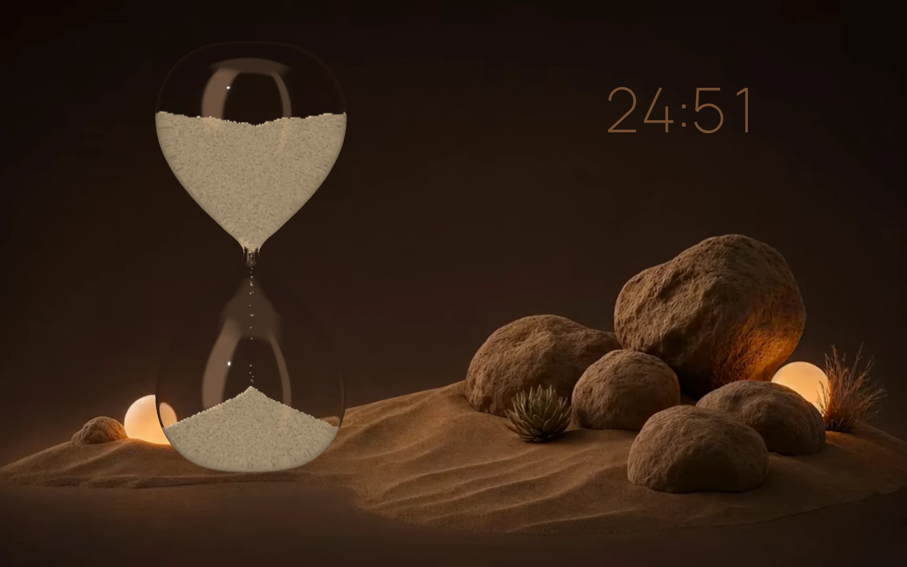
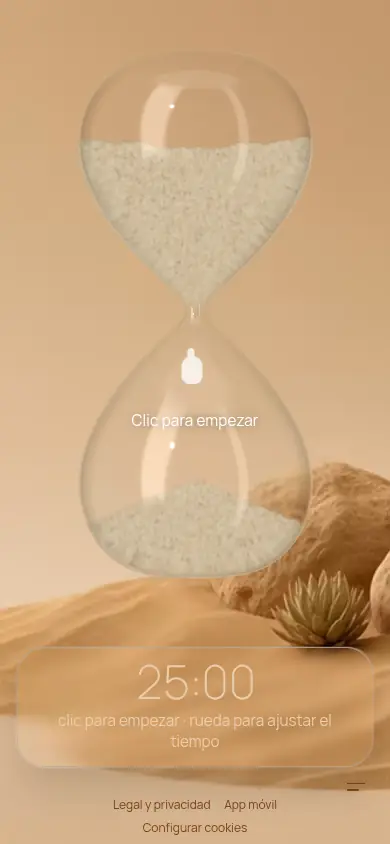

# Hourglass


Temporizador pomodoro con forma de reloj de arena. El tiempo no es una barra: es arena o agua dentro del frasco. Hay dos apps, web y Android, y comparten la lógica.

La web está en [hourglass.sebastianzaruha.com](https://hourglass.sebastianzaruha.com).
La app de Android se descarga desde [GitHub Releases](https://github.com/SebastianZaruha/hourglass-pomodoro/releases/latest) (APK, fuera de Google Play).

## Escenas

Tres escenas, cada una en claro y en oscuro.

- **Lluvia.** Foto de fondo, agua y una nube. Es la escena de inicio.
- **Arena.** Foto de fondo y arena.
- **Clásico.** El reloj de arena sobre el fondo de siempre.




## Funciones

- La rueda (en la web) o el deslizamiento (en el móvil) fija el tiempo. No arranca la cuenta.
- En el móvil, mantener pulsado reinicia el tiempo y gira el frasco. En la web, ese giro es el doble clic.
- En el móvil, girar el teléfono a horizontal pone el reloj en pausa.
- Ciclos de trabajo y descanso, o una sola sesión.
- Sonido al terminar.
- Español e inglés.
- En la web, las cookies de analítica solo se cargan si se aceptan.

## Stack

Monorepo de npm workspaces.

- `apps/web`: Vite y TypeScript. El frasco es un vidrio 3D (three.js) y el contenido se pinta en un lienzo 2D.
- `apps/mobile`: Expo 58, React Native, Skia y Reanimated.
- `packages/core`: TypeScript compartido. El temporizador, las sesiones, los ajustes, los idiomas y la física viven aquí. No importa las apps.

## Estructura

```
hourglass-pomodoro/
├── package.json
├── packages/core/          @reloj/core
├── apps/web/               @reloj/web
├── apps/mobile/            @reloj/mobile
├── scripts/build-apk.mjs   APK de Android
└── docs/                   arquitectura y capturas
```

## Cómo ejecutarlo

Hace falta Node.js 22.13 o superior.

```bash
git clone https://github.com/SebastianZaruha/hourglass-pomodoro.git
cd hourglass-pomodoro
npm install
npm run dev
```

`npm run dev` abre la web en http://localhost:5173.

### APK de Android

Hacen falta el JDK y el SDK de Android (`ANDROID_HOME`). El proyecto nativo se genera una vez:

```bash
cd apps/mobile
npx expo prebuild -p android
cd ../..
node scripts/build-apk.mjs
```

El APK queda en `apps/mobile/android/app/build/outputs/apk/release/`. Solo incluye arm64-v8a.

El APK publicado se descarga desde [GitHub Releases](https://github.com/SebastianZaruha/hourglass-pomodoro/releases).

## Licencia

[PolyForm Noncommercial 1.0.0](LICENSE.md). Uso personal y no comercial.

## Autor

Sebastián Zaruha · [github.com/SebastianZaruha](https://github.com/SebastianZaruha)

Más detalle: [docs/ARQUITECTURA.md](docs/ARQUITECTURA.md). Historial: [CHANGELOG.md](CHANGELOG.md).
