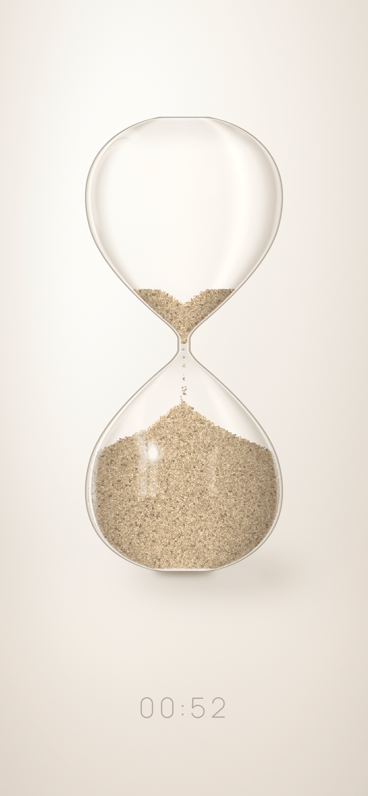
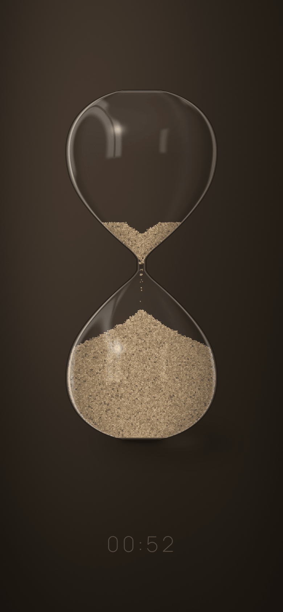
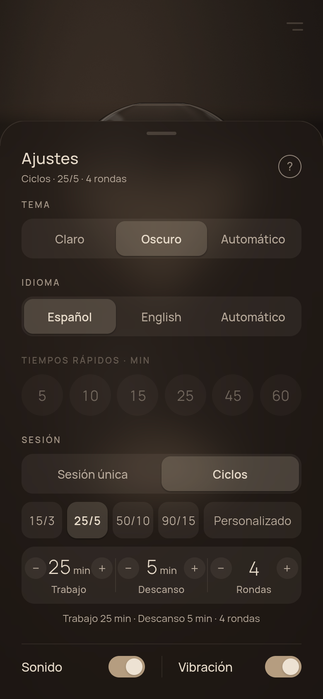
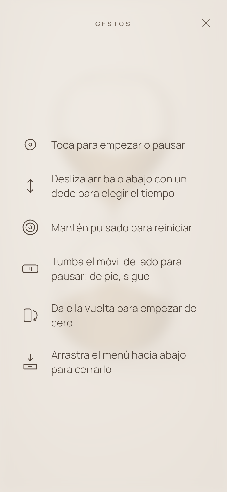

# Reloj de Arena ⏳

**Un temporizador minimalista que es, literalmente, un reloj de arena: la arena cae grano a
grano, se desliza al inclinar el móvil y empieza de nuevo al darle la vuelta.**

> **English summary.** _Reloj de Arena_ ("hourglass") is a minimalist timer app for Android
> built with Expo / React Native, React Native Skia shaders and a real granular sand
> simulation. Tilt the phone and the sand slides; lay it on its side to pause; flip it to
> restart. A discreet frosted-glass menu adds light/dark/auto themes, quick times, work/break
> cycles and Spanish/English/automatic language (the app is fully translated). The same core
> powers a separate browser app (`apps/web`, Vite): an upright glass hourglass, mouse controls,
> and no tilt sensor. TypeScript monorepo with a pure, fully tested core. Documentation is in
> Spanish. Source-available under the [PolyForm Noncommercial 1.0.0](LICENSE.md) license
> (personal and noncommercial use only; the app's name, logo and graphics are not licensed).

<p align="center">
  
  
  
  
</p>

## Índice

1. [Características](#características)
2. [Tecnología y por qué](#tecnología-y-por-qué)
3. [Arquitectura](#arquitectura)
4. [Cómo ejecutarlo](#cómo-ejecutarlo)
5. [Tests y calidad](#tests-y-calidad)
6. [Rendimiento y memoria](#rendimiento-y-memoria)
7. [Licencia](#licencia)
8. [Privacidad](#privacidad)
9. [Autor](#autor)

Más documentación: **[docs/ARQUITECTURA.md](docs/ARQUITECTURA.md)** (cómo funciona por dentro y
dónde está cada cosa en el código) y **[CHANGELOG.md](CHANGELOG.md)** (historial de versiones).

---

## Características

La pantalla entera es el reloj: un vidrio fino y transparente con arena que cae de verdad sobre
un fondo cálido y difuso. Todo se maneja con gestos; los ajustes viven en un menú discreto:

| Gesto                       | Acción                                                                  |
| --------------------------- | ----------------------------------------------------------------------- |
| Deslizar **arriba / abajo** | Más / menos tiempo (1 min – 3 h), con un dedo. La arena cambia en vivo. |
| **Tocar**                   | Empezar · pausar («Pausa») · reanudar; al terminar, de nuevo.           |
| **Mantener pulsado**        | Reiniciar.                                                              |
| **Inclinar** el móvil       | La arena se desliza y la luz y la sombra se mueven.                     |
| **Tumbar de lado** (≈90°)   | Pausa (reloj desenfocado y «Pausa»); de pie, sigue.                     |
| **Voltear** (180°)          | Como uno real: empieza de cero y cae la arena del otro lado.            |

Además, el menú (las dos rayas de abajo a la derecha abren una hoja baja, cerca del pulgar)
tiene pestañas para sesión única (tiempos rápidos, o Personalizado con una barra a todo el
ancho que se arrastra a izquierda y derecha) o ciclos de trabajo y descanso y, en una fila
de botones redondos, tema claro, oscuro o automático, español e inglés, sonido, vibración y, en
Android, una ventana flotante con el reloj encima de otras apps (mantén pulsado un botón redondo
para ver su nombre). La pantalla **«Gestos»** explica todo lo anterior: sale sola la primera vez
y se abre con el «?» del menú.

## Tecnología y por qué

| Pieza                                            | Por qué                                                                                                                                        |
| ------------------------------------------------ | ---------------------------------------------------------------------------------------------------------------------------------------------- |
| **Expo SDK 58 + React Native 0.88** (TypeScript) | Una sola base de código para Android, iOS y web; _development build_ propio sin depender de Expo Go.                                           |
| **@shopify/react-native-skia** (shaders SkSL)    | Dibujo por GPU con shaders: vidrio y arena realistas a 60 fps. En web usa **CanvasKit** (Skia en WebAssembly).                                 |
| **Reanimated 4 + Gesture Handler 3**             | La arena se publica en _shared values_: el lienzo se redibuja sin re-renderizar React. Gestos nativos fluidos.                                 |
| **expo-sensors · expo-haptics · expo-audio**     | Acelerómetro (inclinación, pausa, volteo), vibración y sonido.                                                                                 |
| **Módulo local de Expo en Kotlin** (1.7)         | Notificación con cuenta atrás, avisos con la app cerrada y ventana flotante (1.8). Ver [docs/SEGUNDO_PLANO.md](docs/SEGUNDO_PLANO.md).         |
| **Núcleo en TypeScript puro** (`@reloj/core`)    | Temporizador, simulación, física y ajustes sin React ni UI: se prueba con **Vitest** en milisegundos y se reutilizará en la app de escritorio. |
| **npm workspaces** (monorepo)                    | Funciona sin configuración extra con Metro/Expo en Windows.                                                                                    |
| **ESLint + Prettier + TypeScript estricto**      | Un solo comando (`npm run check`) valida tipos, estilo, formato y tests.                                                                       |

Las decisiones con más detalle están en
[docs/ARQUITECTURA.md › Decisiones clave](docs/ARQUITECTURA.md#decisiones-clave-y-por-qué).

## Arquitectura

```
reloj-de-arena/
├── packages/
│   └── core/            @reloj/core · LÓGICA PURA (sin React, sin UI), con tests
│       └── src/         timer · sim · physics · geometry · settings · catalog · session · persistence · recovery
├── apps/
│   ├── mobile/          @reloj/mobile · app Expo / React Native (Android, iOS y vista Expo)
│   └── web/             @reloj/web · app de navegador (Vite + React). No es la vista Expo.
│       ├── app.json     configuración de Expo (nombre, paquete, permisos bloqueados…)
│       ├── assets/      iconos y sonido de fin
│       └── src/
│           ├── screens/      TimerScreen: gestos, accesibilidad, diseño
│           ├── hourglass/    renderizador Skia reutilizable: <Hourglass>, pintores, shaders
│           ├── motion/       acelerómetro → fuente de movimiento; simulador web
│           ├── haptics/      vibración
│           ├── sound/        avisos de fin y de cambio de fase
│           ├── intro/        animación de entrada (solo al arrancar en frío)
│           ├── hooks/        useSession, useSettings…
│           ├── theme/        paletas clara y oscura, tema automático
│           ├── dev/          reloj acelerado para probar ciclos (solo desarrollo)
│           └── components/   tiempo y rótulo de fase, «Pausa», menú de ajustes (menu/)
└── docs/                ARQUITECTURA.md y capturas
```

```
 gestos / sensores / menú ──► useSession ──► motor de sesiones del core (fases encadenadas
                                              con marcas de tiempo, estado inmutable)
                                         │ tiempo restante
                                         ▼
 <Hourglass> ──► bucle de animación (≈60 fps, se duerme si nada se mueve)
                   1. controlador de flujo: ¿cuántos granos deben quedar arriba?
                   2. simulación granular: los granos caen, ruedan y se asientan
                   3. SandPainter → SkPicture → shared value de Reanimated
                                         ▼
 <Canvas> Skia: [fondo + sombra + vidrio] [arena + chorro] [reflejos + contorno]
```

**Regla de oro:** `core` no importa nada de la app; la app importa de `core`. La explicación
completa (temporizador, simulación, shaders, inclinación, vibración, sonido, memoria) y el mapa
archivo por archivo están en **[docs/ARQUITECTURA.md](docs/ARQUITECTURA.md)**.

## Cómo ejecutarlo

### Requisitos

- **Node.js 22.13 o superior** (lo exige Expo SDK 58) y npm, que viene con Node. Comprueba con
  `node -v`.
- Para el móvil: un **Android 7+** con el _development build_ de la app instalado (ver abajo) y
  el ordenador y el móvil en la **misma red Wi‑Fi**.
- Para compilar el APK: **JDK 17** y el **SDK de Android** (con NDK 27.1). No hace falta
  Android Studio.

### Instalar y arrancar

```bash
git clone https://github.com/SebastianZaruha/hourglass-pomodoro.git
cd hourglass-pomodoro
npm install          # instala todo el monorepo (y copia canvaskit.wasm para la vista Expo)
npm run mobile       # servidor de Expo para el móvil (development build)
npm run web          # vista Expo en el navegador (no es apps/web; ver más abajo)
npm run web:dev      # app de navegador (apps/web) en http://localhost:5173
```

En el móvil, abre **Reloj de Arena** (el _development build_): tu PC aparece en la lista de
servidores si estáis en la misma Wi‑Fi, o escanea el **QR** de la terminal. Si no conecta
(VPN, redes de empresa o de invitados): `cd apps/mobile` y `npx expo start --tunnel`. En la
terminal, `r` recarga, `j` abre el depurador y `m` el menú de desarrollo. La primera vez,
Windows puede preguntar si Node.js puede usar la red: acepta en **redes privadas**.

> **Por qué un _development build_ y no Expo Go:** es «tu propio Expo Go», con los módulos
> nativos exactos del proyecto, y no depende de qué versión de Expo Go tenga la Play Store.
> También funciona con **Expo Go 58** (`npx expo-go download android 58`, y en la terminal
> pulsa `s` para cambiar a Expo Go), pero **sin notificación ni avisos en segundo plano**: el
> módulo nativo propio de la 1.7 solo está en el _development build_.

### Compilar el APK de desarrollo

Solo hace falta la primera vez o cuando cambian las **dependencias nativas** (los cambios de
TypeScript se cargan desde el PC sin APK nuevo). La carpeta `android/` se **genera** a partir de
`app.json` y no se guarda en el repositorio:

```bash
cd apps/mobile
npx expo prebuild --platform android --clean
cd android
./gradlew assembleDebug -PreactNativeArchitectures=arm64-v8a
# APK: apps/mobile/android/app/build/outputs/apk/debug/app-debug.apk
```

En Windows (PowerShell) el comando es `.\gradlew assembleDebug -PreactNativeArchitectures=arm64-v8a`.
El parámetro `-PreactNativeArchitectures=arm64-v8a` compila solo para arm64 (todos los Android
de los últimos años) y tarda unas 4 veces menos. Desde la 1.8.6 el `prebuild` ya deja
`reactNativeArchitectures=arm64-v8a` y `expo.useLegacyPackaging=true` en
`android/gradle.properties` (plugin `modules/background-timer/app.plugin.js`); para incluir
todas las arquitecturas, pasa `-PreactNativeArchitectures=armeabi-v7a,arm64-v8a,x86,x86_64`.
Si Gradle se queda sin memoria, añade `-Dorg.gradle.jvmargs=-Xmx3g`.

**APK que no necesita el PC** (desde la 1.8.1): desde la raíz, `npm run apk -- --out
reloj.apk` (1.8.6, `scripts/build-apk.mjs`; necesita `JAVA_HOME` y `ANDROID_HOME`). Borra el
bundle de JS viejo, compila `assembleRelease` solo para arm64 con las librerías comprimidas
(~22 MB) y comprueba el APK: arquitecturas, compresión, versión igual que `app.json` y, con
`--expect "texto"`, que el JavaScript embebido lo contiene. Sale también en
`app/build/outputs/apk/release/app-release.apk`.
Lleva el JavaScript dentro, compilado y minificado, así que va más fluido; no tiene el menú de
desarrollo ni carga los cambios desde el PC.

Para instalarlo: copia el APK al móvil, ábrelo y permite **instalar apps de orígenes
desconocidos**. Está firmado con la clave de depuración estándar, así que Play Protect puede
avisar (_Instalar de todas formas_). El permiso de actividad física que añade `expo-sensors`
está bloqueado en `app.json` (`blockedPermissions`), así que cualquier `prebuild` lo quita.
Desde la 1.7 pide **mostrar notificaciones** (Android 13+, la primera vez que empieza un reloj)
y usa **alarmas exactas** para avisar con la app cerrada (ver
[docs/SEGUNDO_PLANO.md](docs/SEGUNDO_PLANO.md)). `expo-audio` declara además el micrófono
(`RECORD_AUDIO`), que la app no usa ni pide.

### Simular la inclinación en el navegador

Con `npm run web` en modo desarrollo — o en cualquier versión web añadiendo `?inclinar` a la
URL — se simula el acelerómetro con el teclado (haz clic antes en la página):

| Tecla           | Efecto                                               |
| --------------- | ---------------------------------------------------- |
| `←` / `→`       | Girar el móvil 5° a izquierda / derecha              |
| `Mayús` + `←/→` | Girar 30° (dos veces + una normal ≈ 65°; tres = 90°) |
| `↑` / `↓`       | Inclinarlo hacia atrás / delante (mueve la luz)      |
| `V`             | Voltear 180° de golpe                                |
| `0`             | Volver a «de pie»                                    |
| `Alt` + ratón   | Mover el ratón con Alt pulsado gira el móvil         |

Antes de la primera tecla no se simula nada.

**Probar los ciclos sin esperar:** en desarrollo, añade `?velocidad=60` a la URL de la web y el
tiempo corre 60 veces más rápido (un 25/5 dura 30 s). Solo funciona en modo desarrollo.

Para exportar la **vista Expo** estática:
`cd apps/mobile && npx expo export --platform web` (sale en `dist/`).

### App de navegador (`apps/web`)

Es otra app, en el mismo repositorio, que reutiliza `@reloj/core` (temporizador, ciclos,
ajustes, textos y simulación de arena). No cambia el móvil: el vidrio de Android sigue siendo
Skia. En el navegador el reloj se queda de pie (no hay acelerómetro), la arena cae igual, y
se maneja con el ratón:

| Acción                        | Efecto                                                            |
| ----------------------------- | ----------------------------------------------------------------- |
| **Clic** o **Espacio**        | Empezar, pausar o seguir                                          |
| **Doble clic**                | Voltea 180° y reinicia la cuenta                                  |
| **Rueda**                     | Más o menos tiempo (solo si no está en marcha)                    |
| **Arrastrar el reloj**        | Gira el vidrio y apaga la sombra; un giro claro voltea y reinicia |
| Botón de dos rayas (al pasar) | Abre los ajustes; desaparece con el panel abierto                 |

En una ventana ancha hay dos columnas: el reloj a la izquierda y la hora, centrada, a la
derecha. Al abrir ajustes el panel sube desde abajo con un fundido y la hora sube para
dejarle sitio. En una ventana alta el reloj se queda grande y el panel es una tarjeta al
pie, sin encoger el vidrio. Con la pausa puesta no se puede abrir el menú: primero hay que
seguir. En ciclos, el rótulo del tramo (Trabajo 1/4, Descanso…) se ve aunque la cuenta
no haya empezado y el menú esté cerrado. Sesión única tiene Personalizado: la barra se arrastra a izquierda o derecha por los mismos escalones, y − / + siguen un paso.
El panel, de arriba a abajo: título, Sesión única o Ciclos, solo los tiempos de
esa opción, y al fondo tres pastillas (tema, idioma y sonido). No hay vibración ni ventana
flotante. El sonido nace apagado. El tema y el idioma pueden ser claro/oscuro/automático y
español/inglés/automático. Al pausar, «Pausa» queda en el centro de la pantalla y el resto
se desenfoca.

La cuenta sigue aunque la pestaña esté detrás (usa la hora del sistema). Si el aviso del
navegador está permitido y la pestaña no se ve, al cambiar de fase sale una notificación.

```bash
npm run web:dev       # desarrollo, http://localhost:5173
npm run web:build     # estático en apps/web/dist
npm run web:preview   # sirve esa carpeta en http://localhost:4173
```

Variable de entorno (copia `apps/web/.env.example` a `apps/web/.env`):

| Variable                 | Efecto                                                            |
| ------------------------ | ----------------------------------------------------------------- |
| `VITE_GA_MEASUREMENT_ID` | Id de GA4 (`G-…`). Vacío, o un ejemplo con `XXXX`, no carga nada. |

Google Analytics **no** se inserta hasta que se pulsa **Aceptar** en el aviso de cookies, y
solo si ese id es real. Las cookies de GA quedan en el host de la página (`cookie_domain: 'none'`),
no en el dominio padre. **Rechazar** no carga el script. «Configurar cookies» (pie de página
y páginas legales) vuelve a preguntar; retirar el consentimiento borra las cookies `_ga*`
también en `.sebastianzaruha.com` si quedaron de una prueba anterior. Vercel Web Analytics
tampoco se carga hasta Aceptar (no usa cookies). No está desplegada: estos comandos solo la
arrancan en local.

## Tests y calidad

```bash
npm run check        # tipos + ESLint + formato (Prettier) + tests, todo seguido
npm test             # solo los tests (Vitest, paquete core)
npm run test:coverage
```

El núcleo (`packages/core`) tiene **184 tests** en 21 archivos: temporizador (incluidos casos
extremos del final de la cuenta y entradas NaN/Infinity), duraciones, avisos, vibración,
ajustes (y su migración), ciclos y motor de sesiones (fases encadenadas sin perder ni un
milisegundo, pausa, volteo, guardado), geometría y zona del botón del menú, simulación de
arena (avalanchas, volteo, aterrizaje, vaciado en embudo, flujo tras dar la vuelta), chorro de
granos a cualquier fps, textos en español e inglés (mismas claves), filtro del acelerómetro y
máquina de estados de pausa/volteo, y los avisos en segundo plano (alarmas, pausar/reanudar/
reiniciar desde la notificación, igual que el motor de sesiones). El módulo Kotlin tiene 31 tests
JUnit propios (incluida la ventana flotante y su dibujo con Robolectric) (`cd apps/mobile/android && ./gradlew :background-timer:testDebugUnitTest`).
La app se comprueba con tipos, ESLint (incluido React Compiler), pruebas de extremo a extremo
en la web con Playwright y pruebas manuales en Android (ver [CHANGELOG](CHANGELOG.md)).

## Rendimiento y memoria

Medido en la versión web (Chromium sin GPU, 390×844, ~25 s con el chorro activo; versión 1.4):

| Momento                                 | Memoria WASM (CanvasKit) | JS heap | FPS |
| --------------------------------------- | ------------------------ | ------- | --- |
| Al abrir                                | 128,0 MB                 | 24,2 MB | —   |
| En marcha                               | 128,0 MB                 | 24,9 MB | ~52 |
| Tras pausar, reanudar y voltear (≈25 s) | 128,0 MB                 | 25,4 MB | ~39 |

- **La memoria no crece:** no se crea ningún objeto Skia ni JS persistente por fotograma (todo
  se reutiliza o se libera con retraso). Los 128 MB son la reserva inicial de CanvasKit.
- Los FPS de la tabla son **sin GPU** (todo por software); en el móvil, con GPU, la animación
  va fluida. La simulación cuesta ~0,2 ms por fotograma; con la arena quieta el bucle se duerme.
- Detalles y mediciones de cada versión en el [CHANGELOG](CHANGELOG.md).

## Versiones principales

| Paquete                                   | Versión                          |
| ----------------------------------------- | -------------------------------- |
| Expo SDK                                  | 58 (`expo` 58.0.17)              |
| React Native                              | 0.88.0                           |
| React                                     | 19.3.0                           |
| @shopify/react-native-skia                | 2.14.0 (CanvasKit 0.41.0 en web) |
| react-native-reanimated / worklets        | 4.7.1 / 0.13.0                   |
| react-native-gesture-handler              | 3.3.0 (API de hooks v3)          |
| @react-native-async-storage/async-storage | 2.2.0                            |
| expo-audio                                | 58.0.10 (nuevo en 1.1)           |
| expo-dev-client                           | 58.0.14 (nuevo en 1.1)           |
| expo-haptics                              | 58.0.7 (nuevo en 1.3)            |
| expo-sensors                              | 58.0.4 (nuevo en 1.3)            |
| TypeScript                                | 6.0.3                            |
| Vitest                                    | 5.0.5                            |
| ESLint / Prettier                         | 9.39 / 3.9                       |
| Node.js usado para desarrollar            | 22.23.4                          |
| APK: JDK / Gradle / NDK                   | 17 / 9.4.1 / 27.1 (solo arm64)   |

Tipografía: **Manrope** (ExtraLight para el tiempo; Light, Regular, Medium y SemiBold en el
menú y los rótulos), vía `@expo-google-fonts/manrope`.

Los avisos de licencia de las dependencias están en
[THIRD_PARTY_NOTICES.md](THIRD_PARTY_NOTICES.md).

## Licencia

Este código es público para que puedas verlo, aprender de él y usarlo con fines personales o no
comerciales, bajo la licencia [PolyForm Noncommercial 1.0.0](LICENSE.md). No está permitido el
uso comercial ni redistribuirlo con ánimo de lucro sin mi permiso. El nombre, el logo y los
gráficos de la app no están incluidos en la licencia. ¿Te interesa un uso comercial? Escríbeme a
[sebastianzaruha+apps@gmail.com](mailto:sebastianzaruha+apps@gmail.com).

Texto completo de la licencia: [PolyForm Noncommercial 1.0.0](https://polyformproject.org/licenses/noncommercial/1.0.0)

## Privacidad

La app de Android no tiene cuentas, anuncios, analítica ni servidor: no envía datos fuera del
móvil. La app de navegador (`apps/web`) tampoco tiene cuentas. Solo si la persona pulsa
Aceptar carga Vercel Web Analytics (sin cookies) y, si hay un id real en
`VITE_GA_MEASUREMENT_ID`, Google Analytics.

- Política de privacidad (español): [docs/privacidad.html](docs/privacidad.html)
- Privacy policy (English): [docs/privacy.html](docs/privacy.html)
- Cookies: [docs/cookies.html](docs/cookies.html) · [docs/cookies-en.html](docs/cookies-en.html)
- Aviso legal: [docs/aviso-legal.html](docs/aviso-legal.html) · [docs/legal-notice.html](docs/legal-notice.html)

Son páginas HTML: con GitHub Pages (o un visor de HTML) se ven ya formateadas; en el repositorio
se muestra el código fuente. La app de navegador las sirve desde `apps/web/public`.

## Autor

**Sebastián Zaruha** — [github.com/SebastianZaruha](https://github.com/SebastianZaruha)
